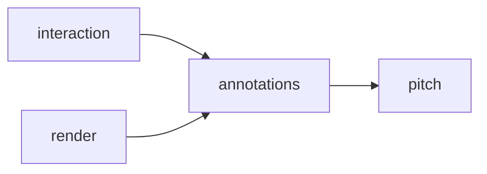

# Pitch Annotations: Design

**Pitch annotations** let you mark up the pitch while you think through a play, as on chess.com's analysis board:
- **Right-drag** from one square to another draws an arrow.
- **Double right-click** on a player draws a ring around them.
- **Any left click** clears every mark.

Marks only exist on the pitch. They are never saved and never change the board.

The player menu (status, dugout boxes, Comment) moves from a plain right-click to **Ctrl + right-click**.

Status: built (Phase 13 in [task.md](task.md)); the requirements are §3.12 of the [PRD](prd.md).

## Decisions

**Confirmed with the user**
1. The player menu opens with **Ctrl + right-click**. In the sandbox, a plain right click is used only for marks. On the main menu and the Team setups screen, right-click renames as before, with or without Ctrl.
2. Arrows snap **from square centre to square centre**. Drawing the same arrow again removes it. The reverse direction counts as a different arrow.
3. **Any left press on the sandbox clears every mark.** That includes presses on the pitch, the dugouts, the dice buttons, Save setup, Team setups and Main menu.

**Defaults (veto any)**
- **Arrow:** right-press on a pitch square, then right-release on a *different* pitch square.
  - A press or a release off the pitch draws nothing.
  - A release on the press square is a click, not an arrow.
- **Preview:** while the right button is held, a preview arrow runs from the press square to the hovered square, drawn like a real one. It goes away when the cursor leaves the pitch or comes back to the press square.
- **Ring:** two right clicks on the same **occupied** pitch square within `DOUBLE_CLICK_SECONDS = 0.4` toggle a ring on that square.
  - A click is a press and a release on the same square. The 0.4 s are measured from the first click's release to the second click's release.
  - After a double click, the next click starts a new pair, so a triple click doesn't toggle twice.
  - A double click on an empty square, a dugout or the panel does nothing. A single right click does nothing visible.
- **Marks belong to squares, not players.** A left drag clears them on its press, so moving a player never leaves a stale ring behind.
- **Lifetime:** marks live in `Interaction`, so they go whenever the session makes a new one: Main menu, Team setups and back, or a deploy. They are not in setup files.
- **Look:** one colour, `MARK_COLOUR = (255, 170, 0, 160)`, translucent orange as on chess.com.
  - The arrow's shaft is 0.22 squares wide, and its head is 0.55 squares wide and 0.45 squares long. The tail starts at the start square's centre, and the tip ends at the end square's centre.
  - The ring has a radius of `square_size // 2 - 1` and a width of `max(2, square_size // 10)`.
- **Draw order:** scene → pieces → marks → panel → context menu.
  - Marks are drawn onto a per-frame `SRCALPHA` surface the size of the pitch, which is then blitted at the pitch's origin.
  - On that surface, overlapping marks overwrite each other rather than stacking darker. The surface also clips every mark to the pitch.
- **Interplay:**
  - A mark press is ignored during a left drag.
  - A mark press first saves an open comment edit and closes an open menu, as a right-click does today.
  - All right-button input is ignored while the name box is open.
- **No cap** on the number of arrows. Drawing loops over the marks tuple, so it is bounded by the tuple's length.

## Input

| Event (sandbox) | Effect |
|---|---|
| Right press on a pitch square | Saves an open comment edit and closes the menu. Remembers the square as the arrow's start. Ignored during a left drag |
| Right press off the pitch | Saves an edit and closes the menu, as above; there is no start square, so the release draws nothing |
| Mouse move, right button held | The view shows the preview arrow when the cursor is on another pitch square |
| Right release on another pitch square | `toggle_arrow(start → square)` |
| Right release on the start square | A click. If the last click was on the same occupied square within 0.4 s, `toggle_circle(square)`; otherwise it is remembered as the last click |
| Right release off the pitch | Nothing; the start square is forgotten |
| Ctrl + right press | Opens the player menu, as a plain right press did before (`Interaction.right_click`) |
| Left press anywhere | `clear_marks()` first, then whatever the press did before |

```mermaid
stateDiagram-v2
  Idle --> Drawing: right press on pitch
  Drawing --> Idle: release on another square (toggle arrow)
  Drawing --> Idle: release on start square (click; 2nd within 0.4 s on a player toggles ring)
  Drawing --> Idle: release off pitch
  Idle --> Idle: left press (clear marks)
```



## Arrow geometry

`arrow_polygon(start, end, square_size)` returns 7 points in pixels. Let `u` be the unit vector from start to end and `n` the unit vector perpendicular to it. Let `w = 0.11 · s` be half the shaft's width, `h = 0.275 · s` half the head's width, and `L = 0.45 · s` the head's length, where `s` is the square size. The head's base is `b = end − u·L`.

```
              b+n·h
               |\
 start+n·w ----+ \          points, in order:
   |       b+n·w  \           start+n·w, b+n·w, b+n·h, end,
   *start          > end      b−n·h, b−n·w, start−n·w
   |       b−n·w  /
 start−n·w ----+ /
               |/
              b−n·h
```

The shortest arrow joins neighbouring squares, so its length is at least `s`, which is longer than `L`. The head therefore always fits. A diagonal neighbour is `s·√2` away.

## Primitives

| Type | Module | Meaning |
|---|---|---|
| `Arrow(start, end)` | annotations | An arrow between two pitch squares; `start != end` |
| `Marks(arrows, circles)` | annotations | Every mark on the pitch: tuples, in the order they were drawn, with no duplicates |

## Modules

| Module | Status | Job |
|---|---|---|
| `annotations.py` | **new**, no pygame, no pydantic | The `Arrow` and `Marks` primitives, the toggles and the arrow polygon |
| `interaction.py` | extend | Right press and release, the double click timing, `clear_marks`, the marks and the preview in the view |
| `session.py` | extend | Routes plain and Ctrl right presses, and the right release; a sandbox left press clears the marks |
| `render.py` | extend | `MARK_COLOUR` and `_draw_marks` |
| `app.py` | extend | Reads Ctrl on a right press; forwards the right button's release |

`board`, `layout`, `pitch` and the file modules don't change. Marks never reach `Board`. Only `render` and `app` import pygame, as before.


There are no cycles.

## Public interfaces

```python
# annotations.py
class Arrow(NamedTuple): start: Square; end: Square
class Marks(NamedTuple): arrows: tuple[Arrow, ...] = (); circles: tuple[Square, ...] = ()
def toggle_arrow(marks: Marks, arrow: Arrow) -> Marks     # appends it, or removes it if already there
def toggle_circle(marks: Marks, square: Square) -> Marks  # likewise
def arrow_polygon(start: tuple[float, float], end: tuple[float, float],
                  square_size: int) -> tuple[tuple[float, float], ...]
                                                          # 7 points, see Arrow geometry;
                                                          # ValueError if start == end or square_size <= 0

# interaction.py
DOUBLE_CLICK_SECONDS = 0.4
Interaction(board: Board, layout: Layout, clock: Callable[[], float] = time.monotonic)
                                        # the clock times double clicks; tests pass a fake one
Interaction.mark_press(pos) -> None
Interaction.mark_release(pos) -> None
Interaction.clear_marks() -> None       # also forgets a press in progress and the last click
Interaction.right_click(pos) -> None    # unchanged: opens the player menu (now reached with Ctrl)
InteractionView.marks: Marks = Marks()  # the marks plus the preview arrow, if any; the default
                                        # keeps existing InteractionView(...) calls working

# session.py
Session.right_click(pos, ctrl: bool = False) -> None
    # SANDBOX: ctrl → interaction.right_click, else → interaction.mark_press
    # MENU and TEAM_SETUPS: rename as today; ctrl is ignored
Session.right_release(pos) -> None      # SANDBOX only → interaction.mark_release
# _press_sandbox calls interaction.clear_marks() first, before the buttons and dice

# render.py
MARK_COLOUR = (255, 170, 0, 160)
def _draw_marks(surface: pygame.Surface, layout: Layout, marks: Marks) -> None
# draw_sandbox keeps its signature and calls _draw_marks(surface, layout, view.marks)
# right after _draw_pieces

# app.py
# MOUSEBUTTONDOWN, RIGHT_BUTTON → session.right_click(event.pos, ctrl=bool(pygame.key.get_mods() & pygame.KMOD_CTRL))
# MOUSEBUTTONUP,   RIGHT_BUTTON → session.right_release(event.pos)
```

Interaction's private state grows by three fields:
- `_marks: Marks`;
- `_mark_start: Square | None`, the press square while the right button is held;
- `_last_click: tuple[Square, float] | None`, for the double click.

## Invariants and errors

- Marks never change the `Board`, and nothing in them is saved.
- Every `Arrow` joins two different pitch squares, and every ring sits on a pitch square. `Interaction` only builds them from `layout.square_at`, which returns pitch squares or None.
- `Marks` holds no duplicates, because both toggles remove an existing mark instead of adding it again.
- User input never raises. A press or release off the pitch just does nothing.
- Contract violations raise `ValueError`: `arrow_polygon` with `start == end` or `square_size <= 0`.

## Testing

| File | Expected | Edge | Failure |
|---|---|---|---|
| test_annotations | `toggle_arrow` and `toggle_circle` add, then remove; `arrow_polygon`'s 4th point is `end`, and its 1st and 7th points are centred on `start` | the reverse arrow is a separate mark; horizontal, vertical and diagonal arrows have a head symmetric about the shaft; neighbouring squares still fit the head | `arrow_polygon` with `start == end`, or `square_size` 0, raises `ValueError` |
| test_interaction | a drag from A to B adds `Arrow(A, B)`; a double click on a player adds a ring; the view shows the preview mid-drag; `clear_marks` empties everything | a second double click removes the ring; the same arrow again removes it; a click pair 0.5 s apart (fake clock) adds nothing; a triple click toggles once | a press or release off the pitch, and a double click on an empty square, add nothing; a mark press during a left drag is ignored |
| test_session | a left press on the pitch, a dice button and Save setup clears the marks; `right_click(pos, ctrl=True)` opens the menu | a plain right-click on MENU still opens the rename box | right input is ignored while the name box is open |
| test_render | an arrow and a ring change pixels inside the pitch | a ring on a corner square changes no pixel outside the pitch box | with no marks, the frame is the same as before this feature |
| test_app | RIGHT down and up on two squares draws an arrow; with `pygame.key.set_mods(pygame.KMOD_CTRL)`, a RIGHT press opens the menu | — | — |

**Existing tests:** sandbox tests that open the menu through `Session.right_click` or app RIGHT events now need `ctrl=True`, or `pygame.key.set_mods(pygame.KMOD_CTRL)`. Tests that call `Interaction.right_click` directly don't change.

**Manual check:**
1. Start a match. Right-drag from a Home player to a square three columns ahead: an orange arrow follows the cursor and stays after the release.
2. Right-drag the same arrow again: it disappears. Draw it back.
3. Double right-click an Away player: they get a ring. Double right-click them again: it's gone. Put it back.
4. Right-drag from the pitch into the panel: no arrow.
5. Ctrl + right-click a player: the menu opens. Pick Prone: the marks are gone, because the pick was a left click.
6. Draw an arrow and click Roll on a die: the marks clear, and the dice roll.

## Build order

Tests first at each step, then `uv run pytest`.
1. `annotations.py` + test_annotations.
2. interaction: the clock, `mark_press`, `mark_release`, `clear_marks`, `InteractionView.marks`, + test_interaction.
3. session: `right_click(pos, ctrl)`, `right_release`, the clear in `_press_sandbox`, + test_session; update the existing menu tests.
4. render: `MARK_COLOUR`, `_draw_marks`, + test_render. Then check a headless screenshot with an arrow and a ring.
5. app: Ctrl on a RIGHT press and the RIGHT release, + test_app.
6. Docs: README "Marking the pitch" section; the Comment line becomes "Ctrl + right-click a player"; tick task.md; the status line here.

## Traceability

| Requirement (PRD §3.12) | Where |
|---|---|
| Right-drag draws an arrow | `Interaction.mark_press` / `mark_release`, `annotations.toggle_arrow`, `render._draw_marks`, `arrow_polygon` |
| Double right-click rings a player | `Interaction.mark_release` (`_last_click`, `DOUBLE_CLICK_SECONDS`), `annotations.toggle_circle` |
| Left click anywhere clears | `Session._press_sandbox` → `Interaction.clear_marks` |
| Marks only on the pitch | `layout.square_at` gates every mark; the pitch-sized overlay clips the drawing |
| Player menu on Ctrl + right-click | `app.handle_event` (`KMOD_CTRL`), `Session.right_click(pos, ctrl)` |

## NASA rules

Checked against [architecture_principles.md](architecture_principles.md):
- **1:** at most 2 nesting levels in `mark_release` and `Session.right_click`.
- **2:** drawing loops over `Marks`. The toggles keep it free of duplicates, so it is bounded by the pitch's squares.
- **3:** no resources; the overlay surface is a local of `_draw_marks`.
- **4:** every new function stays at 60 lines or fewer.
- **5:** `arrow_polygon` checks its arguments. Interaction only makes marks from `square_at` results.
- **6:** nothing can fail at runtime; input off the pitch is ignored on purpose.
- **7:** mark state lives in `Interaction`. There is no module state, and the clock is injected.
- **8:** no I/O.
- **10:** still not enforced by any linter (already in task.md).
- **12:** the tests above.

## Notes

- `pygame.key.get_mods()` is read in `app`, so `session` and `interaction` stay free of Pygame.
- Pygame 2.6.1's mouse events carry no click count, which is why `Interaction` times double clicks with its own clock.
- `interaction.py` is about 400 lines and grows by about 80.
