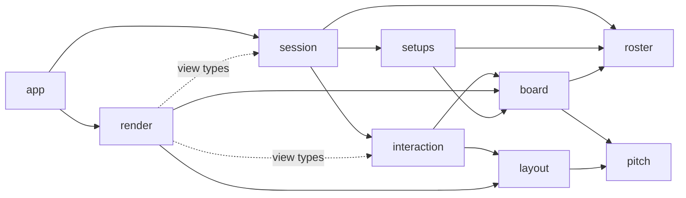

# Plan: Architecture & component design for PRD Phases 2–4 (`/sc:design docs/prd.md`)

## Context
Phase 1 is finished. `layout.py` holds the pure screen geometry, `render.py` draws the static scene and `app.py` runs the loop.
Phases 2–4 have no design yet: roster import, the sandbox mechanics and save/load. The PRD also leaves several choices open.
`/sc:design` turns the PRD into a design doc that `/sc:implement` can later build module by module.
The doc has to follow CLAUDE.md (black-box modules, primitives first, wrapped dependencies, simplicity) and the NASA rules in `docs/architecture_principles.md`.

**Decisions confirmed with the user**
- Right-click opens a **context menu**: Stand up / Prone / Stunned / Remove.
- Files are picked from **in-app lists** of `rosters/*.csv` and `setups/*.json`. Save writes a timestamped file. No tkinter and no text input.
- The **ball is independent**: it stays put when its carrier is dragged away.
- The ruleset is **Blood Bowl Third Season (2025)**: MA 1–9, ST 1–8, AG 1+–6+, PA 1+–6+ or none, AV 3+–11+. These limits are unchanged from 2020.

**My own defaults (the doc lists them so you can veto any)**
- The CSV header uses the rulebook names ST and PA (the PRD's STR/PAS).
- AG, PA and AV are written as printed: `3+`, with `-` for no PA. The `+` is optional.
- Shirt number = roster row (1–16). Team name = the CSV file name without its extension.
- Sprites are drawn in code: a token in the team colour with the shirt number and a "head" bar on its top edge, so the 90°/180° rotations are visible. A player with an image in `sprites/` is drawn from it instead: see [sprites.md](sprites.md).
- Dropping a player on one of their own dugout boxes (Reserve, KO, Injured) benches them there. Benching resets the player to Standing.
- The sandbox gets a **Main menu** button, which is the way back to the setups list. Leaving discards any unsaved board.
- The file lists rescan when the window regains focus, so there is no Refresh button.
  - To name a setup, rename its file in Explorer.
- Home and away may use the same CSV (a mirror match).

## Deliverables (after approval)
1. **Create `docs/architecture.md`** with the design below. It will include:
   - Mermaid diagrams: components, screen states, the drag-and-drop sequence and the file data flow.
   - ASCII mockups of the menu and the sandbox.
   - A table tracing each PRD requirement to the design.
   - A checklist against the NASA rules, with sources for the stat limits.
2. **`CLAUDE.md`**: add one line to the Documentation list, `- [Architecture & component design](docs/architecture.md)`.
3. **`docs/task.md`**: add three items under "Discovered During Work":
   - Create `pitch.py` and move `PITCH_COLUMNS`/`PITCH_ROWS` into it. This is the first Phase 2 step.
   - Add `rosters/example.csv` as the format reference and a roster for manual testing.
   - No linter or type checker enforces rule 10 ("warnings are errors"); only black is configured.

No source code changes: this is a design task. No commit unless asked.

## Design (content of docs/architecture.md)

### Primitives (the data types every module shares)
| Type | Module | Definition |
|---|---|---|
| `Square` | pitch | frozen dataclass `(column, row)`. Raises `ValueError` outside 26×15, so an off-pitch square can't exist. |
| `Side` | pitch | Enum `HOME="home"`, `AWAY="away"`. Picks the dugout area, the colour and the JSON key. |
| `Dugout` | pitch | Enum `RESERVE`, `KO`, `INJURED`: a team's off-pitch boxes. `DUGOUT_CAPACITY` = 18 / 9 / 9. Saved by value. |
| `Status` | pitch | Enum `STANDING`, `PRONE`, `STUNNED`. Render maps these to 0°/90°/180°. Saved by name. |
| `PlayerKey` | pitch | NamedTuple `(side, index)`. A player's identity on the board; shirt number = index + 1. |
| `Player`, `Team` | roster | Frozen pydantic models holding the validated roster data. |
| `Board` | board | The only mutable game state. |
| `Box` | layout | Existing NamedTuple, plus `contains(pos)`. Used for every hit test and every drawn rectangle. |

### Modules and dependency rules
| Module | Status | Job | External imports |
|---|---|---|---|
| `pitch.py` | new | Board vocabulary. Takes over `PITCH_COLUMNS`/`PITCH_ROWS`; layout imports them back. | — |
| `roster.py` | new | CSV → validated `Team`; lists `rosters/` | csv, pydantic |
| `board.py` | new | Sandbox state and its invariants | — |
| `setups.py` | new | `Board` ↔ JSON; lists `setups/`; names new saves | pydantic |
| `layout.py` | extend | All screen geometry, including the geometry used for hit tests | — |
| `interaction.py` | new | Pointer input → board commands: drag, drop, hover, context menu | — |
| `session.py` | new | Screens, menu picks, the file actions, the status message | — |
| `render.py` | extend | All drawing | pygame |
| `app.py` | extend | Window, loop, and the mapping from Pygame events to session calls | pygame |

- Only `render`/`app` import pygame, and only `roster`/`setups` import pydantic/csv.
  - `roster` and `setups` turn `ValidationError`, `OSError` and `UnicodeDecodeError` into `RosterError`/`SetupFileError`, so no caller ever sees pydantic.
- Layers, with no cycles:
  - pitch ← roster ← board ← setups
  - pitch ← layout
  - board + layout ← interaction
  - interaction + roster + setups ← session
  - layout + board + views ← render
  - session + render ← app
- Drawing and hit tests take their rectangles from `layout`, so no position is computed twice.



### Public interfaces
```python
# pitch.py
PITCH_COLUMNS = 26; PITCH_ROWS = 15
class Square: column: int; row: int            # frozen, bounds-checked
class Side(Enum): HOME; AWAY
class Status(Enum): STANDING; PRONE; STUNNED
class PlayerKey(NamedTuple): side: Side; index: int

# roster.py
MAX_TEAM_SIZE = 16
class Player(BaseModel): name; position; ma 1-9; st 1-8; ag 1-6; pa 1-6 | None; av 3-11; skills: tuple[str, ...]
class Team(BaseModel): name; race; players: tuple[Player, ...]   # 1-16
class RosterError(Exception)
def load_team(path: Path) -> Team
def read_race(path: Path) -> str                           # first line only, for the menu list
def list_rosters(folder: Path) -> tuple[Path, ...]         # sorted; a missing folder gives ()

# board.py
class Board:
    def __init__(self, home: Team, away: Team)  # everyone in Reserve and standing; ball on Square(13, 7)
    def team(side) -> Team; player(key) -> Player; keys() -> tuple[PlayerKey, ...]
    def square_of(key) -> Square | None; status_of(key) -> Status; player_at(square) -> PlayerKey | None
    ball: Square                                # read-only
    def place(key, square) -> bool              # False, and nothing changes, if another player is there
    def dugout_of(key) -> Dugout | None; dugout_players(side, dugout) -> tuple[PlayerKey, ...]  # roster order = packing order
    def bench(key, dugout=RESERVE) -> bool      # to that box, status back to STANDING; False if the box is full
    def set_status(key, status) -> None         # ValueError if the player is benched
    def move_ball(square) -> None               # any square; may share it with a player

# setups.py
class SetupFileError(Exception)
def save_setup(board: Board, path: Path) -> None  # writes a temp file then os.replace; creates the folder
def load_setup(path: Path) -> Board               # validates, then rebuilds through Board's public API
def list_setups(folder: Path) -> tuple[Path, ...]
def new_setup_path(folder: Path, board: Board, when: datetime) -> Path  # <home>-vs-<away>-YYYYMMDD-HHMMSS.json

# layout.py additions
Box.contains(pos) -> bool
Layout.square_at(pos) -> Square | None              # inverse of square()
Layout.dugout_area(side) -> Box                     # a team's half under the pitch
Layout.dugout(side, dugout) -> Box                  # Reserve (6 columns), KO and Injured (3 columns), left to right
Layout.dugout_slot(side, dugout, ordinal) -> Box    # 3 slot rows below the caption; players packed in roster order
Layout.dugout_slot_at(pos) -> tuple[Side, Dugout, int] | None
Layout.ball_box(square, carried: bool) -> Box       # half a square: centred, or in the bottom-right corner when carried
Layout.context_menu(anchor: Box, items: int) -> tuple[Box, ...]  # next to the square, left of the panel, inside the window
Layout.save_button, Layout.menu_button: Box         # bottom of the panel
Layout.sandbox_message_line: Box                    # implemented: save/load feedback above save_button
Layout.start_button: Box; Layout.menu_rows: int
Layout.menu_row(which: MenuList, index) -> Box; Layout.menu_row_at(pos) -> tuple[MenuList, int] | None
Layout.menu_preview_line(which, index) -> Box       # PREVIEW_LINES (17) half-square lines below the rows
                                                    # MenuList = HOME_ROSTERS | AWAY_ROSTERS | SETUPS

# interaction.py
class Interaction:
    def __init__(self, board: Board, layout: Layout)
    def press(pos) / move(pos) / release(pos) / right_click(pos) -> None
    def view() -> InteractionView   # hovered: PlayerKey | None
                                    # dragged: Drag(item: PlayerKey | BALL, box: Box) | None
                                    # menu: tuple[MenuItem(label, box), ...]
# Implemented: `dragged` carries the token's moved Box rather than its centre, so
# render needs no geometry of its own; the drop uses that box's centre.

# session.py
class Screen(Enum): MENU; SANDBOX
FileRequest = ImportRoster(side, path) | LoadSetup(path) | SaveSetup()
class Session:
    def __init__(self, layout, rosters_dir: Path, setups_dir: Path)  # MENU screen; no I/O in the constructor
    screen; message; board; interaction             # read-only; board and interaction exist only in SANDBOX
    def menu_view() -> MenuView                     # RosterEntry(name, race | None) rows, setup names, home and away Team | None
    def press(pos) -> FileRequest | None            # no disk I/O: Start and Main menu switch screens, sandbox clicks go to Interaction
    def release(pos) / move(pos) / right_click(pos) -> None
    def rescan() / import_team(side, path) / load_setup(path) / save_setup() -> None
                                                    # the only methods that touch the disk; errors become `message`

# render.py additions (draw_scene stays as it is)
def draw_menu(surface, layout, font, menu: MenuView, message: str) -> None
def draw_sandbox(surface, layout, font, board: Board, view: InteractionView, message: str) -> None
# Implemented in Phase 3 without `message`; Phase 4 added it for save/load feedback.
```
`app.run()` keeps its signature. It builds `Session(layout, Path("rosters"), Path("setups"))` and calls `rescan()` once at startup. In the loop it maps each event to session calls:
- **Left button down:** `match session.press(pos)` dispatches the file request by name, so the I/O is visible at the call site (rule 8).
- **Left button up, right button down, mouse motion:** sent straight to the matching session method.
- **`WINDOWFOCUSGAINED`, and after every save:** `rescan()`.

### File formats
Roster CSV:
```csv
race,Orc
name,position,MA,ST,AG,PA,AV,skills
Grishnak,Blitzer,5,3,3+,4+,10+,Block;Mighty Blow
Ugluk,Lineman,5,3,3+,-,10+,
```
- Encoding and layout:
  - UTF-8; the BOM Excel writes is accepted. Comma-separated.
  - Line 1 is `race,<name>` (key case-insensitive, value trimmed and required). Trailing blank cells are accepted, since Excel pads short rows.
  - Line 2 is the header. It is case-insensitive and its columns can come in any order, but it must have exactly these 8 columns.
  - `position` is required free text (Lineman, Blitzer, ...).
- Main menu: each roster is listed as `name (Race)` (`(invalid)` if its race line is unreadable); the picked team is previewed below the list as `Race - N players` and `#n name  position` lines.
- Rows:
  - 1–16 data rows. Reading stops at row 17 with an error, which bounds the loop (rule 2).
  - Skills are separated by `;`, trimmed, and kept as free text.
- Errors name the file, the line and the field, for example `orcs.csv line 4: av: Input should be less than or equal to 11`.

Setup JSON:
```json
{"version": 1, "ball": {"column": 13, "row": 7},
 "home": {"name": "orcs", "race": "Orc", "players": [
   {"player": {"name": "Grishnak", "position": "Blitzer", "ma": 5, "st": 3, "ag": 3, "pa": 4, "av": 10, "skills": ["Block"]},
    "square": {"column": 3, "row": 7}, "status": "prone"},
   {"player": {"...": "..."}, "square": null, "status": "standing"}]},
 "away": {"...": "..."}}
```
- Each team carries its full roster, so a save still loads if the CSV later changes or moves.
- Each position is stored next to its player, so the two lists can never get out of step.
- `square: null` means the player is off the pitch, in the box named by `dugout` (`"reserve"`, `"ko"`, `"injured"`). Files without `dugout` (saved before the boxes existed) load into Reserve.
- Load rejects the file when any of these holds:
  - the JSON is malformed or doesn't match the schema;
  - the version isn't 1;
  - a roster breaks the stat limits;
  - a square is off the pitch;
  - two players share a square;
  - a player has both a `square` and a `dugout`;
  - a dugout box holds more than its capacity;
  - a benched player isn't standing.

### Interaction rules
- **Press:** an open context menu takes the click first: it applies the item under the cursor, or just closes. Otherwise the press picks up the first thing under the cursor:
  1. the ball's box;
  2. the player on that square;
  3. a dugout slot.

  If none of these is there, nothing happens.
- **Drag:** the token keeps its grab offset and follows the cursor. The board doesn't change until release, and the origin square is drawn empty.
- **Release:** the token's centre decides:
  - Over a pitch square, a player is placed with `place`. It is refused if another player is there, and the token goes back. The ball is moved with `move_ball`.
  - A player over one of their own dugout boxes is benched there with `bench`. A full box refuses, and the token goes back.
  - Anywhere else, the token goes back.
  - A release with no drag in progress is ignored. So is a press during a drag.
- **Right-click:** on a player on the pitch, it opens the menu (Stand up / Prone / Stunned / Reserve / KO / Injured) next to their square. Any menu already open closes first. Players in the dugout boxes and the ball have no menu.
- **Hover:** the panel shows the dragged player, or else the player under the cursor, on the pitch or in a dugout box. It lists:
  - the shirt number, name and team;
  - MA, ST, AG, PA and AV (AG as `3+`, PA as `-`);
  - the skills.

  The ball is ignored for hover.
- **Drawing:** a token is drawn rotated 90° when prone and 180° when stunned (`pygame.transform.rotate`). The ball is drawn above the tokens.
- **Long file lists:** a list longer than `menu_rows` shows its first rows plus a "+N more" line, which keeps every draw loop bounded (rule 2).

### Invariants and errors
- **Board invariants:**
  - every player has exactly one location;
  - no two players share a square;
  - a benched player is standing;
  - the ball is on the pitch.
- **One source of truth:** a single `PlayerKey → (Square | None, Status)` dict. `player_at` scans at most 32 entries, so there is no second index to keep in sync.
- **Contract violations raise `ValueError`:** an unknown key, `set_status` on a benched player, or a slot beyond capacity.
- **User-facing failures raise `RosterError` or `SetupFileError`:** a bad CSV, a bad JSON or an I/O error. Session turns them into the message line; nothing is swallowed.
- **Safe saves:** all files are opened with `with`. Saves write a temp file and then `os.replace` it, so a failed save never corrupts an existing file.

### Testing
`tests/` mirrors `src/`. Each module gets tests for expected use, an edge case and a failure case:
- `test_pitch`.
- `test_roster`, with CSVs written to `tmp_path`.
- `test_board`.
- `test_setups`: a save/load round trip, plus tampered files.
- `test_layout`: `square_at` against `square`, slot capacity, menu and context-menu geometry.
- `test_interaction`: scripted press, move and release sequences.
- `test_session`: temporary `rosters/` and `setups/` folders.
- `test_render`: sampling pixels on an off-screen surface.
- `test_app`: posted events, after `monkeypatch.chdir(tmp_path)`.

### Build order (matches the phases in docs/task.md)
- **Phase 2:**
  1. `pitch.py`
  2. `roster.py` and `rosters/example.csv`
  3. `board.py`
  4. layout: the menu lists and the reserve slots
  5. session: the menu half
  6. render: the menu, and tokens in the reserves
  7. app: the wiring
- **Phase 3:**
  1. layout: `square_at`, `ball_box` and `context_menu`
  2. `interaction.py`
  3. render: the ball, dragging, the panel and the context menu
  4. session: forwarding input to `Interaction`
- **Phase 4:**
  1. `setups.py`
  2. session: save and load, and the setups list

## Verification
1. Re-read `docs/architecture.md`:
   - Every PRD item in §3.1–3.4 and in Phases 2–4 appears in the traceability table with its module and interface.
   - Each of the 12 NASA rules has a checklist entry.
2. Check that the Mermaid blocks use only basic syntax that GitHub renders (`flowchart`, `stateDiagram-v2`, `sequenceDiagram`).
3. Run `uv run pytest` as a sanity check: no code changes, so it must still pass.
4. Check that `git status` shows only the new `docs/architecture.md`, one line in `CLAUDE.md` and three lines in `docs/task.md`.

## Notes
- CLAUDE.md names `prompt.md` as the PRD, but that file doesn't exist; the real PRD is `docs/prd.md`. I'll mention this and leave CLAUDE.md's wording alone.
- Sources for the limits:
  - [bloodbowlbase.ru, BB2025 rules](https://bloodbowlbase.ru/bb2025/core_rules/rules_and_regulations/) (a fan site)
  - [Warhammer Community, Third Season changes](https://www.warhammer-community.com/en-gb/articles/euo6nxbn/tokens-skills-and-roster-changes-whats-new-in-blood-bowl/) (no new stats)
  - [Goonhammer, BB2020](https://goonhammer.com/blood-bowl-2020-whats-new-with-the-new-edition) (target-number notation and min/max limits)
