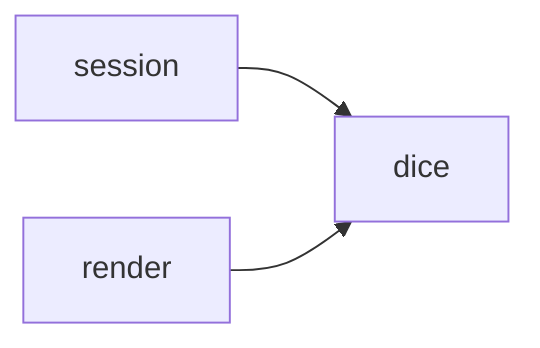
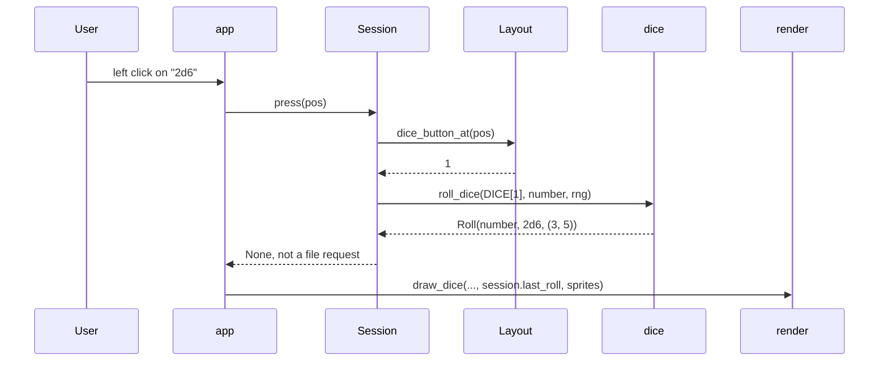

# Dice Roller: Design

During a match the sandbox has no dice, so players roll somewhere else. This feature adds a **dice section** to the sandbox panel:
- seven buttons: 1d6, 2d6, 1d8, 1d16, 1 block, 2 blocks and 3 blocks;
- the last roll: one die per die rolled, plus the total for numbered dice;
- **block dice drawn from sprite images**. A face whose image is missing shows its name instead.

Status: implemented (Phase 6 in [task.md](task.md)); the requirements are §3.6 of the [PRD](prd.md). Where the build differs from this design, see [Implementation notes](#implementation-notes).
It builds on commit `5147769` (the Reserve, KO and Injured dugout boxes, which made the window 1120x656 at square size 32).

## Decisions

**Confirmed with the user**
- **Buttons:** 1d6, 2d6, 1 block, 2 blocks, 3 blocks, 1d8 and 1d16.
- **Images:** block dice use sprites, and a face whose image is missing falls back to words.
- **Folder:** `sprites/dice/`, next to the player images in `sprites/home/` and `sprites/away/`, and like them relative to the folder the app is launched from. Moved there from `src/bb_sandbox/sprites/dice/`, inside the package, on 2026-10-24.
- **Files:** one PNG per face, added later. No images ship with this feature.

**Defaults (veto any)**
- **Placement:** the sandbox's right panel, between the player info and the message line. Only the sandbox has dice.
- **Face names** are Third Season's, the ruleset confirmed in [design.md](design.md): Player Down!, Both Down, Push Back (on 2 of the 6 sides), Stumble and POW!. They are the fallback words; lowercased with `_` they are the file names.
- **Rows:** numbered dice first (1d6, 2d6, 1d8, 1d16), then block dice (1 block, 2 blocks, 3 blocks).
- **Result line:** `#<n>  <label>`, plus ` = <total>` for numbered dice, e.g. `#12  2d6 = 8`.
  - n counts the rolls in this sandbox, so a roll that repeats the last faces still changes the screen.
  - One block die repeats its face 22% of the time, because Push Back is on 2 sides.
- **Numbers** are drawn in a second, bigger font (size 40) on a light die face.
- **An image that exists but can't be decoded** stops the app at startup with a `SpriteError` naming the file, like a broken `races.csv`. Only a *missing* image falls back to words.
- **The roll isn't saved** in setup files and starts empty in each sandbox. Rolling leaves the message line and an open context menu alone.

## Screen
At square size 32 the dice take the bottom of the panel (x 864–1104), above the message line:
```
+------------------------------+ y=16
| Player Info                  |
| #3 Grishnak / orcs (home)    | 48: hover text, clipped at y=304
| MA 5  ST 3  AG 3+ ... Skills |
|------------------------------| y=304 dice_area
| Dice                         |
| [1d6 ][2d6 ][1d8 ][1d16]     | y=336
| [1 block][2 blocks][3 blocks]| y=376
| #12  3 blocks                | y=416
| +------+ +------+ +------+   | y=448
| | POW! | | Push | |Player|   |
| |      | | Back | | Down!|   |
| +------+ +------+ +------+   | y=512
| message line                 | y=520
| [        Save setup        ] | y=560
| [        Main menu         ] | y=600
+------------------------------+ y=640
```
The player info above the dice keeps 256px (17 lines). Every positional in `races.csv` fits: Rotspawn, with 9 skills, needs 13 lines.

## Primitives
| Type | Module | Definition |
|---|---|---|
| `BlockFace` | dice | Enum whose values are the printed names: `PLAYER_DOWN="Player Down!"`, `BOTH_DOWN="Both Down"`, `PUSH_BACK="Push Back"`, `STUMBLE="Stumble"`, `POW="POW!"`. A face's sprite file is `name.lower() + ".png"`. |
| `D6`, `D8`, `D16`, `BLOCK_DIE` | dice | A die is the tuple of its faces: `D6 = tuple(range(1, 7))` and so on. `BLOCK_DIE` has 6 faces, with `PUSH_BACK` twice. |
| `Dice` | dice | NamedTuple `(label, count, die)`: what one button rolls, e.g. `Dice("2d6", 2, D6)`. |
| `DICE` | dice | The 7 buttons in layout order: 1d6, 2d6, 1d8, 1d16, 1 block, 2 blocks, 3 blocks. |
| `Roll` | dice | NamedTuple `(number, dice, faces)`. Property `total`: the sum for numbered dice, `None` for block dice. |

Every die rolls the same way, `rng.choice(dice.die)` once per die, so numbered and block dice need no separate code.

## Modules and dependencies
| Module | Status | Job |
|---|---|---|
| `dice.py` | new | The dice vocabulary and `roll_dice`. No I/O, no pygame. |
| `layout.py` | extend | Dice area, buttons, result line, die boxes and `dice_button_at`; the geometry lives in a `_dice_region` helper |
| `session.py` | extend | Owns the RNG and `last_roll`; dice clicks in `_press_sandbox` |
| `render.py` | extend | `DICE_SPRITES_DIR`, `SpriteError`, `load_block_sprites`, `draw_dice`; the player info is clipped above the dice |
| `app.py` | extend | Loads the sprites and the die font after `set_mode`; draws the dice on the sandbox |

- pygame stays in render and app.
- Layout doesn't import dice. It has its own capacities, `DICE_BUTTON_ROWS` and `DIE_BOXES`, which tests check against `DICE` and `MAX_DICE`, as `RACE_ROWS` is checked against `MAX_RACES`.
- `DICE_SPRITES_DIR` sits next to its loader, as `RACES_FILE` sits next to `load_races`; app imports both.
- New dependency edges are below. There are no cycles, and the existing edges stay as they are:


## Public interfaces
```python
# dice.py
MAX_DICE = 3                                           # the most dice in one roll
class BlockFace(Enum): PLAYER_DOWN; BOTH_DOWN; PUSH_BACK; STUMBLE; POW   # value = printed name
D6, D8, D16: tuple[int, ...]; BLOCK_DIE: tuple[BlockFace, ...]
class Dice(NamedTuple): label: str; count: int; die: tuple[int | BlockFace, ...]
DICE: tuple[Dice, ...]                                 # the 7 buttons, in layout order
class Roll(NamedTuple): number: int; dice: Dice; faces: tuple[int | BlockFace, ...]
    total -> int | None                                # property; None for block dice
def roll_dice(dice: Dice, number: int, rng: random.Random) -> Roll   # ValueError: count outside 1..MAX_DICE

# layout.py
DICE_BUTTON_ROWS = (4, 3)                              # buttons per row, top to bottom, in DICE order
DIE_BOXES = 3                                          # >= MAX_DICE
Layout.dice_area: Box                                  # panel width, from the "Dice" caption row down to the message line
Layout.dice_buttons: tuple[Box, ...]                   # one per DICE entry
Layout.dice_result_line: Box
Layout.die_boxes: tuple[Box, ...]                      # square, left to right
Layout.dice_button_at(pos) -> int | None               # index into DICE

# session.py
Session(layout, rosters_dir, setups_dir, races, rng: random.Random | None = None)  # None -> random.Random()
last_roll: Roll | None                                 # read-only; None off the sandbox and before the first roll

# render.py
DICE_SPRITES_DIR = Path("sprites") / "dice"
DIE_FILL, DIE_TEXT                                     # light die face, dark text
class SpriteError(Exception)
def load_block_sprites(folder: Path, size: int) -> dict[BlockFace, pygame.Surface]
def draw_dice(surface, layout, font, die_font, roll: Roll | None, sprites) -> None

# app.py
DIE_FONT_SIZE = 40
```
App changes:
- `run()`, right after `set_mode`:
  - creates `die_font = pygame.font.Font(None, DIE_FONT_SIZE)`;
  - calls `load_block_sprites(DICE_SPRITES_DIR, layout.die_boxes[0].width)`. A `SpriteError` stops the app, and the `finally` still quits pygame.
- `_draw(surface, layout, font, die_font, sprites, session)`: on the sandbox, `draw_dice(...)` follows `draw_sandbox(...)`.
- `handle_event` doesn't change: a dice click goes through `session.press`, which returns `None`.

## A roll, step by step


## Layout
The dice stack upwards from the message line, with `BUTTON_INSET` (8px) gaps. The inner width is `panel.width - 2 * BUTTON_INSET` (224px).
- **Die boxes:** `min(2 * square_size, (inner - (DIE_BOXES - 1) * BUTTON_INSET) // DIE_BOXES)` square, which is 64px at size 32.
  - Their bottom edge sits `BUTTON_INSET` above `sandbox_message_line`.
  - They run left to right from `panel.x + BUTTON_INSET`, `BUTTON_INSET` apart.
- **Result line:** directly above the die boxes, one square high and the inner width.
- **Button rows:** above the result line, `BUTTON_INSET` apart. A row of n buttons splits the inner width into n equal buttons, `(inner - (n - 1) * BUTTON_INSET) // n` wide.
- **Caption row:** one square directly above the first button row. `dice_area` runs from its top to the message line, across the panel's full width.

At square size 32:
- die boxes: y 448–512, at x 872, 944 and 1016;
- result line: y 416;
- block row: y 376, 3 buttons of 69px;
- number row: y 336, 4 buttons of 50px;
- caption: y 304, so `dice_area = Box(864, 304, 240, 216)`.

**Fit**, measured at font size 20:
- "1d16" is 29px wide in a 50px button; "2 blocks" and "3 blocks" are 52px in 69px.
- Words wrap at spaces. The widest word, "Stumble" (53px), fits a 64px die; "Player Down!" (84px) takes two lines.

At tiny square sizes the stack runs above the panel. `build_layout` still succeeds; only size 32 is tested, as for the other regions.

## Session rules
- **SANDBOX:** `_press_sandbox` checks Save setup, then Main menu, then `dice_button_at`.
  - A dice button sets `last_roll = roll_dice(DICE[i], n, rng)`. n is 1 for the first roll and one more for each roll after it.
  - It returns `None`: a roll isn't a file request.
  - The press doesn't reach Interaction, so no drag starts.
- `_open_sandbox` and Main menu set `last_roll` to `None`.
- The dice buttons exist only on the sandbox. On other screens, a click at their position does what it did before.

## Render rules
- **`draw_dice`** (app calls it after `draw_sandbox`) draws:
  - a separator line at the top of `dice_area`, and the "Dice" caption;
  - the 7 buttons via `_draw_button`, labelled with `Dice.label`;
  - when there is a roll: `_roll_text` on the result line, then one die per face in `die_boxes`, left to right.
- **`_draw_die`:** a block face with a sprite blits that sprite, already scaled to the box. Any other face is a `DIE_FILL` square with a `BORDER` outline, holding either:
  - the number, in `die_font`; or
  - the face's words, in `font`, one word per line, centred.
- **`_roll_text(roll)`:** `#12  2d6 = 8`. Block dice have no total: `#12  3 blocks`.
- **`_draw_panel`:** the hover text's clip ends at `layout.dice_area.y` instead of `sandbox_message_line.y`.
- The context menu never covers the panel (`Layout.context_menu` opens left of it), so drawing the dice last hides nothing.

## Sprites
- **Folder:** `sprites/dice/` (`DICE_SPRITES_DIR`).
- **Files:** `player_down.png`, `both_down.png`, `push_back.png`, `stumble.png`, `pow.png`.
  - Any size: each is scaled once at startup to the die box with `smoothscale`. Square images look best; others are stretched.
- **Missing:** each face falls back on its own, so a missing file gives words for that face only. A missing folder gives words for all five.
- **Unreadable:** a file that exists but can't be decoded raises `SpriteError` with the file name and pygame's message.
- **Precondition:** `load_block_sprites` calls `convert_alpha`, which needs the display mode set. Without it the loader raises `ValueError`.

## Invariants and errors
- A roll has 1 to `MAX_DICE` faces, each from its die, so there are always enough die boxes.
- `len(layout.dice_buttons) == len(DICE)`, which tests check.
- **Contract violations raise `ValueError`:**
  - `roll_dice` with a count outside 1..`MAX_DICE`;
  - `load_block_sprites` before the display mode is set.
- **An unreadable image raises `SpriteError`.** Nothing swallows it: the app stops and names the file.
- **One source of randomness:** a `random.Random` owned by Session. The module-level `random` functions are never used, so tests can seed the session.

## Testing
Each module gets tests for expected use, an edge case and a failure case:
- **test_dice** (new):
  - each `DICE` entry rolls `count` faces from its die;
  - the labels are the seven requested ones;
  - `total` is the sum for 2d6 and `None` for block dice;
  - a seeded RNG reaches every block face and both ends of the d16;
  - `BLOCK_DIE` has 6 faces, with Push Back twice;
  - counts of 0 and `MAX_DICE + 1` raise.
- **test_layout:**
  - `sum(DICE_BUTTON_ROWS) == len(DICE)` and `DIE_BOXES >= MAX_DICE`;
  - the buttons and die boxes sit inside `dice_area` and the panel, above the message line, without overlapping;
  - the die boxes are square;
  - `dice_button_at` inverts each button and misses the caption, the gaps and anything outside;
  - `dice_area.y >= panel.y + 9 * 32`, so the caption row plus 8 rows stay free for the player info.
- **test_session:**
  - a dice click sets `last_roll` (dice, face count, number 1, then 2) and returns `None`;
  - the click starts no drag;
  - two sessions seeded the same roll the same faces;
  - Main menu and Start clear the roll;
  - a click at a dice button's position on the main menu doesn't roll.
- **test_render:**
  - with no roll, the buttons are drawn and the die boxes stay empty;
  - a 2d6 roll draws two `DIE_FILL` dice and leaves the third box empty;
  - a block roll with no sprites draws words;
  - a solid-colour POW sprite replaces POW's words, while the other faces stay words;
  - `_roll_text` formats both kinds of roll;
  - `load_block_sprites`: a missing folder gives `{}`, a PNG saved to `tmp_path` loads scaled, a corrupt file raises `SpriteError` naming it, and no display mode raises `ValueError`.
- **test_app:**
  - events drive menu → sandbox → dice click, and `last_roll` is set;
  - `_draw` draws the dice buttons on the sandbox;
  - with `DICE_SPRITES_DIR` monkeypatched to a folder holding a corrupt PNG, `run()` raises `SpriteError` and pygame is quit;
  - `run(max_frames=3)` still works with no images.
- **Existing tests to update:** only test_app's `frame` fixture, for the new `_draw` arguments. The `rng` default keeps every `Session(...)` call working.

**Manual check:**
1. `uv run bb-sandbox`, import two rosters and Start.
2. Click each button. Block dice show their words; numbered dice show big numbers, and 2d6 shows its total.
3. Click 1 block several times: the roll number goes up even when the face repeats.
4. Put a `pow.png` in `sprites/dice/` and restart. POW shows the image; the other faces still show words.

## Build order (Phase 6)
1. `dice.py` and test_dice.
2. layout.
3. session.
4. render.
5. app.
6. README "Dice" section (the buttons, the sprite folder and the file names); tick Phase 6 in [task.md](task.md).

## Traceability
| Request / answer | Design |
|---|---|
| Dice usable during the match | The dice section of the sandbox panel (`Layout.dice_area`), always next to the pitch |
| Buttons 1d6, 2d6, 1d8, 1d16 | `DICE[0..3]` on the first row; `roll_dice` with `D6`, `D8`, `D16`; 2d6 shows its total |
| Buttons 1 block, 2 blocks, 3 blocks | `DICE[4..6]` on the second row; `BLOCK_DIE`, with Push Back on 2 sides |
| Sprites for block dice | `load_block_sprites(DICE_SPRITES_DIR, ...)` at startup; `_draw_die` blits them |
| Words when images are missing | `_draw_die` falls back per face to the face's name |
| Move the folder to `sprites/` (later request) | `DICE_SPRITES_DIR` = `sprites/dice/` |
| Separate PNGs, added later (answer) | `<face>.png` names; none ship; the README lists them |

## NASA rules
Checked against [architecture_principles.md](architecture_principles.md):
- **1/4:** every new function stays at 60 lines or fewer. The geometry lives in `_dice_region`, so `build_layout` grows by only about 8 lines (it is already over 60, listed in [task.md](task.md)).
- **2:** loops are bounded by 7 buttons, 3 dice, 5 faces and 2 words.
- **3:** `pygame.image.load` opens and closes each file itself.
- **5:** `roll_dice` checks the count and `load_block_sprites` checks the display mode. Tests check the layout capacities against `DICE` and `MAX_DICE`.
- **6:** an unreadable image raises `SpriteError`. A missing image is the requested fallback, not an error.
- **7:** the RNG and the last roll live in Session. There is no new module state besides constants.
- **8:** sprite loading happens in `run()`. A dice click only changes session state.
- **10:** still not enforced by any linter (already listed in [task.md](task.md)).
- **12:** the tests above.

## Notes
- Out of scope: roll history, keyboard shortcuts, animation, D8 direction arrows and rerolls.
- If player tokens later get images loaded the same way, `load_block_sprites` can move into a module of its own.

## Implementation notes
- **One more dependency edge:** `app --> dice`, for `BlockFace` in `_draw`'s `sprites: dict[BlockFace, pygame.Surface]` annotation only. There is still no cycle.
- **Unopenable images:** `load_block_sprites` wraps `OSError` as well as `pygame.error`, as `load_races` does. A file that exists but can't be opened also stops the app with a `SpriteError` naming it.
- **Sizes:** the measurements above hold at size 32. `build_layout` grew by 7 lines, to 137.
- **Extra tests:**
  - test_layout pins the size-32 geometry listed in [Layout](#layout).
  - test_render checks that long hover text stops above `dice_area`, that "Player Down!" stays inside its die, and that the five README file names load.
  - test_session checks that loading a setup from the sandbox restarts the numbering.

## Sources
- [bloodbowlbase.ru, BB2025 cheat sheet](https://bloodbowlbase.ru/bb2025/core_rules/cheat_sheet/): the five block results, Player Down, Both Down, Push Back, Stumble and POW. It's a fan site; if it disagrees with the official Third Season rulebook, the rulebook wins.
