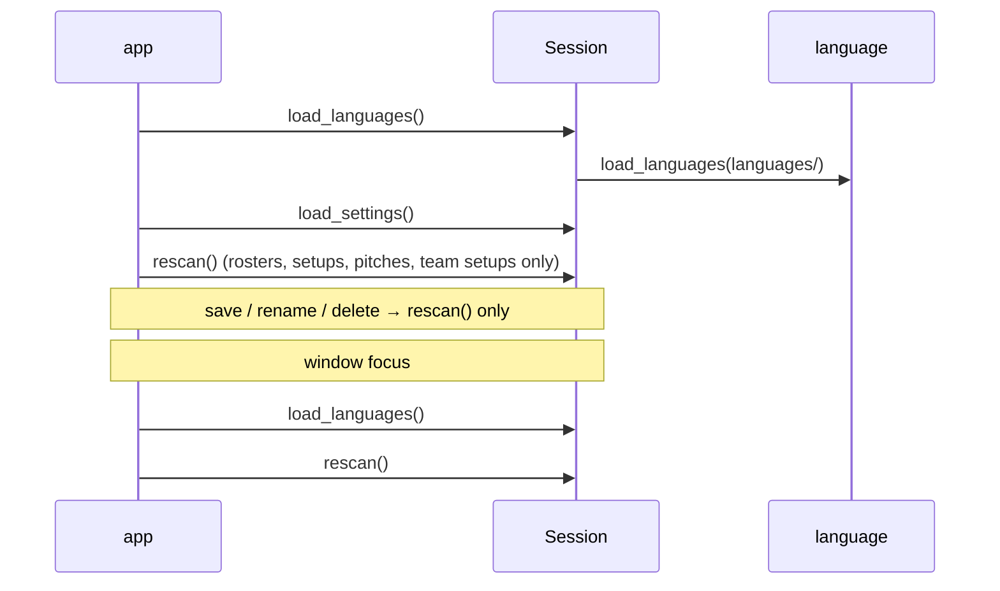

# Language Fixes: Design

Fixes for the nine findings of the `/code-review high` run on the `languages` branch (commit e70814b, 2026-10-28). They tighten [languages.md](languages.md) (Phase 14); no new feature, no new module, no new file format.

Status: built (Phase 15 in [task.md](task.md)); the requirements are §3.13 of the [PRD](prd.md).

## Findings

| # | Finding | Fix |
|---|---|---|
| 1 | A language file can translate `common.raw`. `"Errore: {text}"` turns "no message" (`raw("")`) into visible text, which hides every hint and every sprite or language problem. `""` blanks every file and OS error | **D1** |
| 2 | "No message" is `raw("")`, so it relies on a translatable template giving `''` (root cause of 1) | **D1** |
| 3 | A NUL character in a language file passes validation, and `font.render` then raises `ValueError` while drawing | **D3** |
| 4 | A translation that leaves out an English placeholder is kept, so the team, file name or second error silently vanishes | **D2** |
| 5 | `app.run` calls `load_languages()`, then `rescan()` calls it again: every file is read twice at startup | **D4** |
| 6 | `rescan()` reads every language file on each focus, save, rename and delete | **D4** |
| 7 | A saved language whose file is gone falls back to English without a word | **D5** |
| 8 | `language_row` / `language_row_at` copy `option_row` / `option_row_at` line for line | **D6** |
| 9 | `load_languages` reads `Texts._english`, a private attribute, and builds the names dict twice | **D7** |

Checked while designing:
- Reading 64 copies of `en.json` takes about **12 ms**, so reading the files again on focus is cheap. Only the extra reads go (D4).
- Lone surrogates (`"\ud800"`) also crash `font.render`, with `UnicodeEncodeError`. pydantic already rejects them while parsing the JSON (`string_unicode`), so the file is skipped. Only NUL gets through.

## Decisions

**Confirmed with the user (2026-10-29)**
- **D1. `Text.RAW` is locked.** Raw text is always shown exactly as given and is never looked up in a language file. `common.raw` becomes an ignored key, like any unknown one, and is removed from `en.json`. `raw("")` is then `''` in every language, so the `NO_MESSAGE` sentinel stays and the session needs no change. *(The `Message | None` rewrite was turned down: it would touch about 25 lines of session.py for no extra safety.)*
- **D2. A translation must use exactly the English placeholders**, in any order, each as often as it likes. A text that leaves one out is dropped, and English shows and is reported, as a text with an unknown placeholder is today. *This reverses "or leave some out" in languages.md and the README.*
- **D4. Languages are read at startup and on window focus, nowhere else.** `rescan()` no longer reads them; the focus handler calls `load_languages()` itself. Translators still edit a file, alt-tab back and see the change.
- **D5. A chosen language with no file is reported.** English shows, and `language_problem` says `languages/it.json: file not found` until the file comes back or another language is picked. `settings.json` is not rewritten (unchanged).

**Defaults (veto any)**
- **D3. NUL is rejected while the file is read.** The `name` and every value in `texts`, `races`, `positions` and `skills` must not contain `\x00`. A file with one is skipped and reported, like a non-string value. Keys are never drawn, so they aren't checked.
- **D6.** One private helper per direction, `_option_column_row(column, index, what)` and `_option_column_row_at(column, pos)`. The four public methods keep their names and signatures and become one-line calls. Error messages keep "Option row …" / "Language row …".
- **D7.** `_load_english` also returns the English text map it checked, so `load_languages` never reaches into a `Texts`. A small `_names(data)` builds the races/positions/skills map for both callers.
- **Text.RAW stays a member of `Text`**: `Message.key` must be a `Text`, and every `raw(...)` call site stays as it is.
- **Problem wording stays English**, like every other file problem (languages.md, "Error details stay English").

## Interfaces

Public signatures do not change. What changes behind them:

```python
# language.py
class _LanguageFile(BaseModel):
    name: _Drawable = Field(min_length=1)        # was: str
    texts: dict[str, _Drawable] = {}             # likewise races, positions, skills
_Drawable = Annotated[str, AfterValidator(_no_null)]
    # _no_null(text) -> text; raises ValueError("contains a null character")

def _translatable() -> frozenset[str]            # every Text value except Text.RAW
def _check_texts(texts, english)                 # keeps a key only if it is translatable,
                                                 # its placeholders == the English ones,
                                                 # and it formats (was: <=)
def _names(data: _LanguageFile) -> dict[str, dict[str, str]]
def _load_english(folder) -> tuple[Texts, dict[str, str], str]
                                                 # was: (Texts, problem)

Texts.say(raw(x)) -> x                           # always, in every language; never formatted
                                                 # (a raw "{" or "}" shows as is)

# session.py
Session.rescan()            # no longer calls load_languages()
Session.language_problem    # Languages.problem, else "<languages_dir>/<code>.json:
                            # file not found" when the chosen code has no Texts, else ''

# app.py
run(): load_languages() → load_settings() → rescan()   # one read; comment fixed
handle_event(WINDOWFOCUSGAINED): session.load_languages(); session.rescan()

# layout.py
Layout.option_row(i)      -> self._option_column_row(0, i, "Option")
Layout.language_row(i)    -> self._option_column_row(1, i, "Language")
Layout.option_row_at(p)   -> self._option_column_row_at(0, p)
Layout.language_row_at(p) -> self._option_column_row_at(1, p)
```



## Invariants

- `Texts.say(raw(x)) == x` for every language and every `x`, so `session.message == ''` exactly when no message is set.
- Every text a `Texts` holds uses exactly its English text's placeholders and formats with them.
- No string a language file provides contains `\x00`.
- Language files are read once per startup and once per focus event.
- `language_problem` is `''` only when every file loaded cleanly and the chosen language was found.

## Testing

| File | Expected | Edge | Failure |
|---|---|---|---|
| test_language | an Italian `common.raw` of `"Errore: {text}"` or `""` is ignored: `say(raw("x"))` is `x` and `say(raw(""))` is `''`; a reordered translation with every placeholder is kept | `raw("{")` shows `{`; a placeholder used twice is kept | `"Salvato"` for `message.saved` (leaves out `{name}`) is dropped and reported; a NUL in `name`, a text or a race skips the file and the problem names it |
| test_language_files | `en.json` holds exactly the `Text` keys except `common.raw` | — | — |
| test_session | `language_problem` names `it.json` when settings say `it` and there is no `it.json` | picking English clears it; the file coming back (`load_languages`) clears it | a new `it.json` is **not** listed after `rescan()` alone, only after `load_languages()` |
| test_app | a focus event lists a language file added after start | startup reads the language folder once (count `read_languages` calls) | — |
| test_layout | existing `option_row` / `language_row` tests pass unchanged | — | — |

**Existing tests that change:** the `common.raw` entry in test_language's English fixture goes. `test_a_deleted_language_file_falls_back_to_english_on_rescan` calls `load_languages()` and is renamed `…_on_reload`. Any test that writes a language file after building its session calls `load_languages()` before checking.

**Manual check:**
1. Copy `en.json` to `it.json`, set `"name": "Italiano"` and add `"common.raw": "Errore: {text}"`. Pick Italiano: the main-menu hint still shows and raw errors read as before.
2. Set `message.saved` to `"Salvato"`: the message line reports `message.saved`, and saving shows the English "Saved …".
3. Put `\u0000` into `"name"`: the file is skipped and reported, and Options still opens.
4. Pick Italiano, close the app, delete `it.json`, start again: English shows, and the message line says `languages/it.json: file not found`.

## Build order

Tests first at each step, then `uv run pytest`, `uv run ruff check src tests scripts`, `uv run black src tests`.
1. language: D1, D2, D3, D7, `en.json` without `common.raw` + test_language, test_language_files.
2. layout: D6 (pure refactor; the existing tests are the check).
3. session: `rescan` without `load_languages`, `language_problem` (D4, D5) + test_session.
4. app: focus handler and startup comment (D4) + test_app.
5. Docs: languages.md (Decisions, Keys without `common.raw`, file format, Invariants), README "Languages" (placeholders must all stay), tick task.md, status line here.

## Traceability

| Requirement (PRD §3.13) | Where |
|---|---|
| Robustness: a broken file never stops the app | D3 `_Drawable`; D2 `_check_texts` |
| Error details are not translated | D1 `Texts.say` for `Text.RAW` |
| A missing text shows in English, and a lost language is reported | D5 `Session.language_problem` |
| Files reload on focus | D4 `app.handle_event` |

## NASA rules

Checked against [architecture_principles.md](architecture_principles.md):
- **2:** bounds unchanged (`MAX_LANGUAGES`); the reads per startup drop from 2×N to N.
- **4:** `load_languages` gets shorter (`_names`); the layout helpers remove about 30 lines.
- **5:** `_Drawable` adds a check at the file boundary; `_check_texts` tightens one comparison.
- **6:** nothing new raises while drawing; every rejection becomes `problem`.
- **7:** `Texts` stays a black box: no caller reads its private fields.
