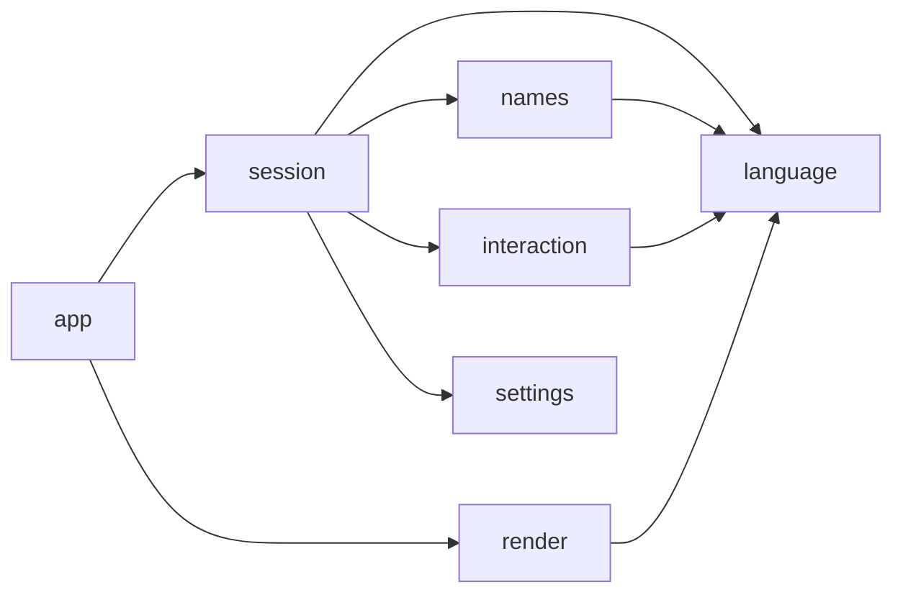
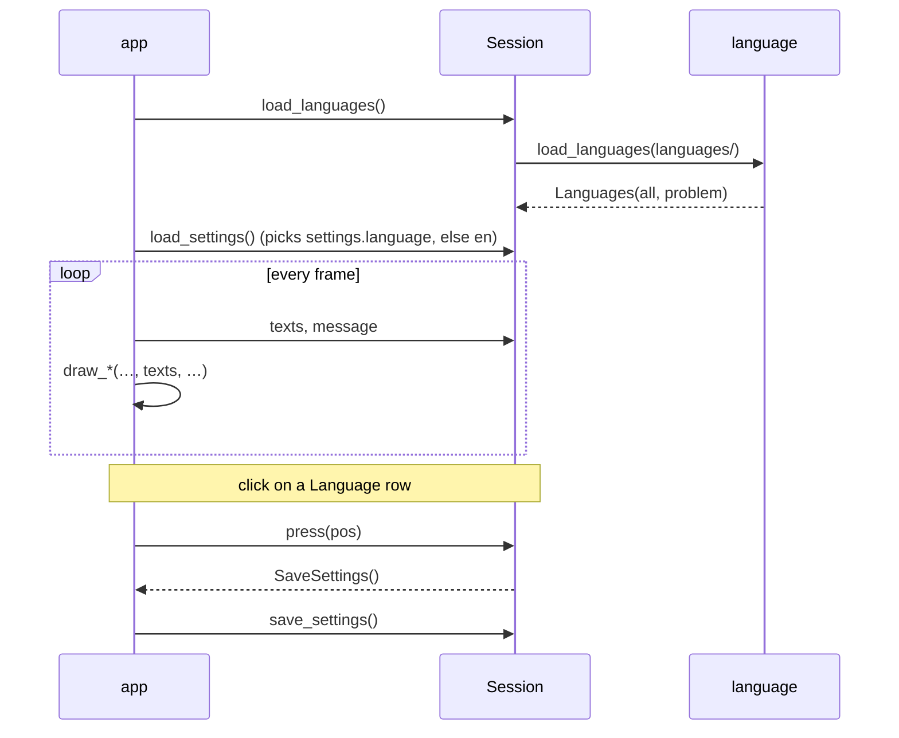

# Languages: Design

**Languages** let you switch every word the app shows. Each language is one JSON file in `languages/`. To add a language, copy `languages/en.json`, translate the values and drop the file back in. The Options screen lists it next to the pitch images.

English is the default and the fallback: a text that a language file leaves out is shown in English.

Status: built (Phase 14 in [task.md](task.md)); the requirements are §3.13 of the [PRD](prd.md).

## Decisions

**Confirmed with the user**
1. **Scope: everything the player reads.** That covers buttons, captions, hints, status messages, the player menu, the block die faces and the stat labels. It also covers **race, position and skill names**.
2. Language files live in **`languages/` at the project root**, next to `rosters/`, `setups/` and `sprites/`. `en.json` ships there and is committed.
3. **A key missing from a language file falls back to English**, one key at a time, so a half-done translation works.
4. **Picker:** a **Language** column on the Options screen, next to **Pitch**. A click switches at once, with no restart, and is saved in `settings.json`. The list shows each file's own display name, e.g. "Italiano".

**Defaults (veto any)**
- **Translation is display-only.** Rosters, setups, team setups, `races.csv`, sprite file names and `settings.json` keep the English names on disk. Switching language never rewrites a file, and old files load as before.
- **User data is never translated:** team names, player names, file names and comments show as typed.
- **Error details stay English.** Errors raised by the file modules (`RosterError`, `SetupFileError`, `TeamSetupError`, `SettingsError`, `RaceError`, `SpriteError`, `LanguageError`, and `FileNameError` when the OS refuses a rename or delete) carry pydantic and OS text that the app does not write. The name box's own checks ("Type a name", "… already exists") *are* translated.
- **The window title** "Blood Bowl Sandbox" is the product name and stays as is.
- **`en.json` is the only source of the English text.** No copy lives in code, so the two can't drift. If `en.json` is missing or broken, the app still runs: it shows each text's key (e.g. `menu.start`) and reports the problem on the message line.
- **Language code = file stem:** `it.json` is `it`, `pt-br.json` is `pt-br`. The code is what `settings.json` stores. English is always `en`.
- **List order:** English first, then the others by display name, ignoring case.
- **Unknown keys are ignored**, so an older or newer file still loads. A text whose `{placeholders}` don't fit the English one is dropped (English is shown) and reported, so formatting never fails while drawing.
- **Skills with a value** such as `Loner (4+)` or `Hatred (Troll)`: the exact name is looked up first, then the name before ` (`. The bracketed part is kept as written. Roster skills that aren't in the file show as written.
- **Reload on focus:** like the roster and setup lists, the languages are read again when the window regains focus. A translator can edit a file, switch back to the app and see the change.
- **Fonts:** the default Pygame font draws Latin-script languages (Italian, French, German, Spanish, Portuguese…). Other scripts need a font with those glyphs, which is out of scope. A missing glyph shows as a box; nothing fails.
- **Long translations are not cut.** Buttons and columns are sized for English, so a much longer text can overflow its box. The README asks translators to keep texts about as long as the English ones.
- **Caps (NASA rule 2):** at most `MAX_LANGUAGES = 64` files are read. The Options column shows as many as fit, plus "+N more", as the pitch list does.

## File format

```json
{
  "version": 1,
  "name": "Italiano",
  "texts": {
    "menu.start": "Inizia",
    "message.saved": "Salvato {name}"
  },
  "races": { "Human": "Umani" },
  "positions": { "Lineman": "Linea" },
  "skills": { "Dodge": "Schivata", "Loner": "Solitario" }
}
```

- `version` must be `1`. `name` must be non-empty. Every section is optional, and every value must be a string.
- **`texts`** uses flat dotted keys (`screen.item`), so two files can be compared line by line. The full key list is the `Text` enum below; `en.json` holds every key.
- **`races`, `positions` and `skills`** are keyed by the English name from `races.csv`. A position shared by several races, such as `Lineman`, has one entry. Skills are keyed by their base name, without ` (…)`. `en.json` lists all of them, mapped to themselves, so a translator sees every name to translate.
- Values may use the same `{placeholders}` as the English text, in any order, or leave some out. `{{` and `}}` give literal braces.
- The file is read as UTF-8; a byte-order mark is accepted.

## Primitives

| Type | Module | Meaning |
|---|---|---|
| `Text` (`StrEnum`) | language | One translatable text; its value is the JSON key, e.g. `Text.START = "menu.start"` |
| `Message(key, values)` | language | A text still to translate: a `Text` plus the values for its placeholders. Session keeps its status message and name-box captions as `Message`s, so they switch language at once too |
| `Texts` | language | One language, frozen: code, display name and every lookup, with the English fallback already merged in |
| `Languages(all, problem)` | language | Every language read from the folder, English first, plus the first problem found ('' for none) |

## Modules

| Module | Status | Job |
|---|---|---|
| `language.py` | **new**, no pygame; pydantic stays inside | `Text`, `Message`, `Texts`, `Languages`, `LanguageError`, `load_languages` |
| `languages/en.json` | **new**, data | Every English text, plus the race, position and skill names |
| `settings.py` | extend | `language: str = "en"`, a bare code like `pitch`'s bare file name; `version` stays 1 |
| `layout.py` | extend | `language_row`, `language_row_at`: the Options rows of `menu_columns[1]` |
| `names.py` | extend | `name_problem` returns `Message \| None`; `FileNameError.message` for the "already exists" cases |
| `interaction.py` | extend | `MENU_ACTIONS` labels become `Text` members; `MenuItem.label` is a `Text` |
| `session.py` | extend | Holds `Languages` and the chosen code; `texts` property; messages and captions as `Message`; the Language column on Options |
| `render.py` | extend | Every `draw_*` takes `texts: Texts` and looks up every caption, label and hint; race, position and skill names go through `texts` |
| `app.py` | extend | `LANGUAGES_DIR = Path("languages")`; passes `session.texts` to each draw; shows `session.language_problem` like the sprite problems |

`dice.py`, `board.py`, `races.py`, `roster.py`, `setups.py`, `team_setups.py` and `pitch.py` don't change. `render` maps `BlockFace` and the block `Dice` to their texts.


`language` imports nothing from the app, so there are no cycles.

## Public interfaces

```python
# language.py
ENGLISH: Final = "en"
MAX_LANGUAGES: Final = 64

class Text(StrEnum):            # every key, see "Keys"; en.json holds exactly these
    START = "menu.start"
    ...

class Message(NamedTuple):
    key: Text
    values: Mapping[str, str | Text | Message] = {}   # filled in with str.format_map;
                                     # a Text or Message value is translated first,
                                     # e.g. {"side": Text.HOME}

def raw(text: str) -> Message        # Message(Text.RAW, {"text": text}): English
                                     # error text shown as is; raw("") is "no message"

class LanguageError(Exception): ...  # a language file can't be read or fails validation;
                                     # the message starts with the file name

class Texts:                         # frozen; built only by load_languages
    code: str                        # file stem, e.g. "it"
    name: str                        # display name, e.g. "Italiano"
    def __getitem__(self, key: Text) -> str        # this language, else English, else key.value
    def say(self, message: Message) -> str         # the text with its values; never raises
    def race(self, name: str) -> str               # translated, else name
    def position(self, name: str) -> str           # translated, else name
    def skill(self, name: str) -> str              # exact, else base + " (…)" kept, else name

class Languages(NamedTuple):
    all: tuple[Texts, ...]           # English first (always present), then by name
    problem: str                     # first file problem, '' for none

def load_languages(folder: Path) -> Languages
    # Reads folder/en.json, then every other *.json (sorted, at most MAX_LANGUAGES).
    # A broken file is skipped and becomes `problem`. A missing or broken en.json
    # gives an English Texts whose lookups return the key; never raises.

# settings.py
class Settings(BaseModel):
    version: Literal[1] = 1
    pitch: str | None = None
    language: str = ENGLISH          # validated: non-empty, no "/", "\\" or ".."

# layout.py
Layout.language_row(index: int) -> Box               # like option_row, in menu_columns[1]
Layout.language_row_at(pos) -> int | None            # like option_row_at

# names.py
def name_problem(name: str) -> Message | None        # was: str, '' for valid
class FileNameError(Exception):
    message: Message                                 # the translatable form; OS failures
                                                     # use raw(str) with the OS text

# interaction.py
MENU_ACTIONS: tuple[tuple[Text, Status | Dugout | MenuCommand], ...]
class MenuItem(NamedTuple): label: Text; box: Box

# session.py
Session(..., languages_dir: Path = Path("languages"))
Session.texts -> Texts                # the chosen language; English if its file is gone
Session.language_problem -> str       # Languages.problem
Session.message -> str                # now texts.say(self._message)
Session.load_languages() -> None      # I/O; app calls it before load_settings
Session.rescan()                      # also calls load_languages()
Session.options_view() -> OptionsView # gains languages, languages_hidden, language
NameView.caption / question: str      # translated in name_view(), stored as Message
# _press_options: a Language row sets the code and returns SaveSettings(),
# as a pitch row does; save_settings writes Settings(pitch=..., language=...)

class OptionsView(NamedTuple):
    pitches: tuple[str, ...]
    hidden: int
    selected: str | None
    languages: tuple[str, ...] = ()   # visible display names, top to bottom
    languages_hidden: int = 0
    language: int = 0                 # index of the chosen one in `languages`, -1 if hidden

# render.py — every public draw function gains `texts: Texts` right after `font`:
draw_menu(surface, layout, font, texts, view, message)
draw_name_box(surface, layout, font, texts, view)
draw_races(surface, layout, font, texts, races, message)
draw_options(surface, layout, font, texts, options, message)
draw_team_setups(surface, layout, font, texts, view, message)
draw_builder(surface, layout, font, texts, builder, message)
draw_sandbox(surface, layout, font, texts, comment_font, board, view, sprites, pitch, message)
draw_dice(surface, layout, font, texts, die_font, roll, sprites)
# The module-level caption constants (MENU_CAPTIONS, DUGOUT_CAPTIONS, MENU_HINT,
# NAME_HINT, TABLE_COLUMNS' headers…) map to Text members instead of strings.
```

## Keys

`en.json`'s `texts` holds one entry per `Text` member. The groups below list each key with its English text and where the string is today. Placeholders are in braces.

| Group | Keys → English | Today in |
|---|---|---|
| common | `common.back` Back · `common.more` +{count} more · `common.raw` {text} · `common.both` {first}; {second} (two problems, e.g. a failed rename roll-back) | render, session |
| side | `side.home` home · `side.away` away (inside sentences) | `Side.value` |
| menu | `menu.home_roster` Home roster · `menu.away_roster` Away roster · `menu.saved_setups` Saved setups · `menu.hint` · `menu.new_roster` New roster · `menu.start` Start · `menu.options` Options · `menu.no_rosters` No CSV files in rosters/ · `menu.no_setups` No JSON files in setups/ · `menu.invalid_race` invalid · `menu.preview` {race} - {count} players | render |
| races | `races.pick` Pick a race | render |
| builder | `builder.caption` {race}: click a positional to add, a player to remove · `builder.size` Roster {count}/{max} · `builder.save` Save roster · `builder.max` Max · `builder.position` Position · `builder.cost` Cost · `builder.skills` Skills | render |
| stat | `stat.ma` MA · `stat.st` ST · `stat.ag` AG · `stat.pa` PA · `stat.av` AV | render (table, panel) |
| options | `options.pitch` Pitch · `options.drawn_pitch` Drawn pitch · `options.no_pitches` No images in sprites/pitch/ · `options.language` Language | render |
| team_setups | `team_setups.hint` · `team_setups.none` No team setups yet · `team_setups.save_home` Save home · `team_setups.save_away` Save away · `team_setups.home_caption` Home: {team} · `team_setups.away_caption` Away: {team} | render |
| sandbox | `sandbox.player_info` Player Info · `sandbox.save_setup` Save setup · `sandbox.team_setups` Team setups · `sandbox.main_menu` Main menu · `sandbox.dice` Dice · `sandbox.team` {team} ({side}) · `sandbox.skills` Skills: · `sandbox.no_skills` none · `sandbox.comment_hint` Enter saves, Esc cancels | render |
| dugout | `dugout.home_reserve` Home Reserve · `dugout.away_reserve` Away Reserve · `dugout.ko` KO · `dugout.injured` Injured | render |
| action | `action.stand_up` Stand up · `action.prone` Prone · `action.stunned` Stunned · `action.reserve` Reserve · `action.ko` KO · `action.injured` Injured · `action.comment` Comment | interaction |
| dice | `dice.block` 1 block · `dice.blocks` {count} blocks · `face.player_down` Player Down! · `face.both_down` Both Down · `face.push_back` Push Back · `face.stumble` Stumble · `face.pow` POW! | dice, render |
| name box | `name.hint` · `name.delete_hint` · `name.confirm_hint` · `name.save_setup` Save setup as · `name.save_roster` Save roster as · `name.save_team_setup` Save {side} setup as · `name.rename_roster` Rename roster · `name.delete_roster` Delete roster and its team setups? · `name.rename_setup` Rename setup · `name.delete_setup` Delete setup? · `name.rename_team_setup` Rename team setup · `name.delete_team_setup` Delete team setup? | session, render |
| name checks | `name.empty` Type a name · `name.chars` Names use letters, digits, spaces, - and _ · `name.too_long` Name is too long · `name.reserved` {name} is reserved · `name.exists` {name} already exists · `name.folder_exists` Folder {name} already exists | names |
| messages | `message.loaded_team` Loaded {team} as {side} · `message.loaded` Loaded {name} · `message.saved` Saved {name} · `message.deployed` Deployed {name} · `message.not_placed` {count} not placed from {name} · `message.deleted` Deleted {name} · `message.deleted_but` Deleted {name}, but {error} · `message.renamed` Renamed {old} to {new} · `message.pick_rosters` Pick a home and an away roster · `message.add_player` Add at least one player · `message.team_full` A team has at most {max} players · `message.no_player` No {side} player on the pitch · `message.team_problem` {team}: {problem} | session |

The dice buttons `1d6`, `2d6`, `1d8` and `1d16` are notation, not words, and stay as they are.

## Flow



On a language click the next frame is already in the new language: the session's message and name-box caption are `Message`s, translated when they are read.

## Invariants and errors

- `Languages.all[0]` is always English with code `en`; `Session.texts` is never None.
- Every `Texts` lookup returns a string and never raises: this language, else English, else the key itself.
- A `Texts` never holds a text whose placeholders aren't among the English text's placeholders, and every text it holds formats. `load_languages` checks both and drops what fails.
- A saved code with no file (deleted, renamed, broken) selects English and does not rewrite `settings.json` until the user picks a language.
- Language files are only read, never written.
- `load_languages` never raises. Its problems reach the message line through `Session.language_problem`, like `PlayerSprites.problem`.
- Contract violations raise `ValueError`: `language_row` with an index out of range, as `option_row` does.

## Testing

| File | Expected | Edge | Failure |
|---|---|---|---|
| test_language | an Italian file translates a text, a race, a position and a skill; `say` fills placeholders in a reordered translation; the list is English first, then by name | a missing key falls back to English; `Loner (4+)` keeps its suffix; a name with no entry is returned as is; with no en.json a lookup returns the key | invalid JSON, a wrong `version`, an empty `name` or a non-string value skip the file and set `problem`; a translation with an unknown `{placeholder}` or a stray `{` is dropped and reported |
| test_language_files | `languages/en.json` holds exactly the `Text` keys | it lists every race, position and skill base name in `races.csv` | — |
| test_settings | `language` round-trips | a file without `language` loads as `en` | `"../x"` or `""` raises `SettingsError` |
| test_layout | `language_row_at(language_row(i))` is `i` | the last row | an out-of-range index raises `ValueError` |
| test_names | `name_problem` returns the right `Message` per case | a valid name gives None | a taken name raises `FileNameError` whose `message.key` is `Text.NAME_EXISTS` |
| test_session | a click on the Italian row returns `SaveSettings` and `texts.code` is `it`; the current message turns Italian at once | a deleted language file falls back to English on `rescan` | a click on "+N more" or an empty row does nothing |
| test_render | `draw_options` draws the Language column; a translated button label changes pixels | — | each `draw_*` still draws with an English-only `Texts` |
| test_app | with `settings.json` saying `it`, the first frame uses the Italian texts | a missing `languages/` still opens in English, with the problem shown | — |

**Existing tests:** every render test that calls a `draw_*` passes an English `Texts`; tests that compare `session.message`, `name_view` captions or `name_problem` keep their English strings, since the default language is English.

**Manual check:**
1. Start the app: everything is in English, and Options shows a Language column with "English" highlighted.
2. Copy `languages/en.json` to `languages/it.json`, set `"name": "Italiano"` and change `menu.start` and `"Human"` in `races`. Alt-tab back: "Italiano" is listed.
3. Click "Italiano": the main menu's Start and the Human race show the Italian text; every text you left as copied still reads in English.
4. Restart: still Italian. Delete `it.json` and alt-tab back: everything is English again.
5. Put `"{nome}"` into `message.saved` in `it.json`: the message line reports it, and saving a setup shows the English message.

## Build order

Tests first at each step, then `uv run pytest`.
1. `language.py` + `languages/en.json` + test_language, test_language_files.
2. settings: the `language` field + test_settings.
3. layout: `language_row`, `language_row_at` + test_layout.
4. names and interaction: `Message`s and `Text` labels + their tests.
5. session: `Message` messages and captions, `load_languages`, `texts`, `language_problem`, the Options Language column + test_session.
6. render: `texts` in every `draw_*`, the Language column + test_render; check a headless screenshot in Italian.
7. app: `LANGUAGES_DIR`, the calls, the problem on the message line + test_app.
8. Docs: README "Languages" section (how to add a language, the length advice); tick task.md; the status line here.

## Traceability

| Requirement (PRD §3.13) | Where |
|---|---|
| One JSON file per language, added by dropping it in | `language.load_languages`, `languages/` |
| English default and per-key fallback | `Texts.__getitem__`, `ENGLISH`, `Settings.language` default |
| Everything translated, including races, positions and skills | `Text` (see Keys), `Texts.race` / `position` / `skill`, `render` |
| Picked on the Options screen, applied at once | `Layout.language_row`, `Session._press_options`, `Message` |
| Saved across runs | `Settings.language`, `Session.save_settings` |
| Bad files never stop the app | `load_languages` problems, `Session.language_problem` |
| Saved files stay English | translation only in `render` and `Texts.say` |

## NASA rules

Checked against [architecture_principles.md](architecture_principles.md):
- **1:** at most 2 nesting levels in `load_languages` (loop over files → try).
- **2:** at most `MAX_LANGUAGES` files; every lookup is a dict access; placeholder checks loop over one string.
- **3:** files are read whole with `read_text`; no handle stays open.
- **4:** `load_languages` is split into `_read_file` and `_check_placeholders` to stay under 60 lines.
- **5:** pydantic checks every file; `Settings` checks the code.
- **6:** every file error becomes a `problem`; nothing raised while drawing.
- **7:** the chosen language lives in `Session`; `language.py` has no module state beyond constants.
- **8:** I/O only in `load_languages`, called from `Session.load_languages`.
- **10:** ruff and mypy: `Text` makes a mistyped key a type error.
- **12:** the tests above.

## Notes

- `render.py` (≈1460 lines) and `session.py` (≈1365 lines) are already in task.md as too large. This feature touches most draw functions but adds little code: each string literal becomes a lookup.
- `todo.md` item 11 ("language plugin that takes from text or md file") is replaced by this design: JSON, as asked.
- A future language picker for non-Latin scripts would need a `font` field in the file and font loading in `app`; nothing here blocks that.
