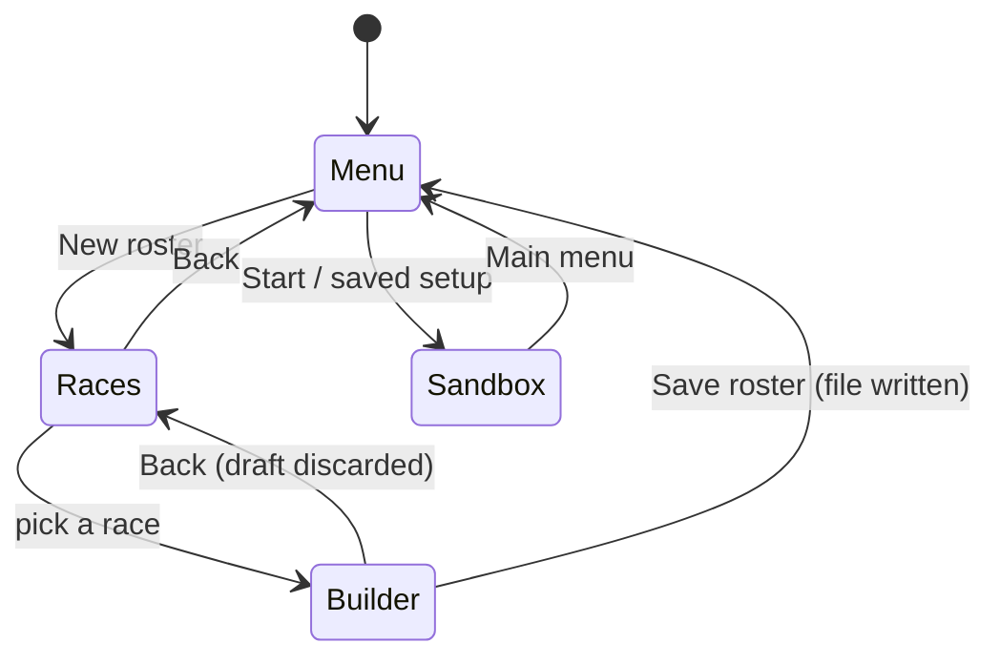
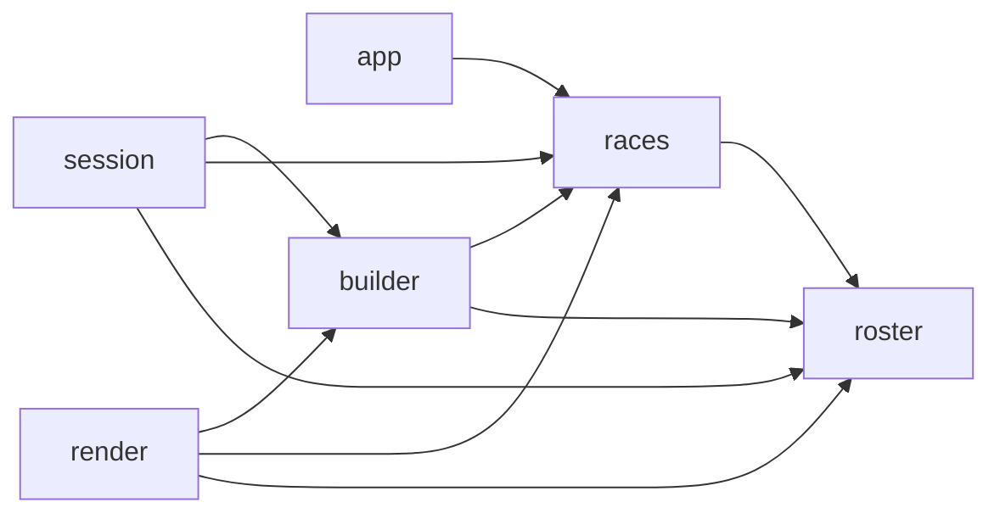

# Race Database & Roster Builder: Design

Rosters can only be imported from hand-written CSVs in `rosters/`. This feature adds three things so rosters can be built in the app:
- a **database of races** with their positionals;
- a **race menu**;
- a **roster builder** where you add positionals. Each one shows its name and stats with the max allowed next to them. The max is shown but never enforced.

Status: implemented (Phase 5 in [task.md](task.md)); the requirements are §3.5 of the [PRD](prd.md). Where the build differs from this design, see [Implementation notes](#implementation-notes).
It builds on commit `d195e40` (`Team.race`, `Player.position`, `read_race`, the main menu preview).

## Decisions

**Confirmed with the user**
- **Flow:** a **New roster** button on the main menu opens the race list, then the builder.
  - **Save roster** writes `rosters/<race>-YYYYMMDD-HHMMSS.csv` and returns to the main menu.
  - The main menu lists the new file in Home and Away like any other CSV. The import path doesn't change.
- **Storage:** a single CSV, `src/bb_sandbox/races.csv`, shipped with the package. It has one row per positional, written in the roster CSV notation.
- **Cost:** each positional has a cost. The builder shows the running total against 1,000K gp; like the max, the budget is shown and never enforced.

**Defaults (veto any)**
- **Data:** all 30 Blood Bowl Third Season (2025) teams from bloodbowlbase.ru/bb2025/teams, with errata applied. This is the ruleset already confirmed in [design.md](design.md).
- **Shared Big Guy limits are not modelled.** These are the asterisk footnotes, e.g. Chaos Chosen "a single Big Guy, chosen from the following". Each Big Guy shows its own 0-1.
- **Team size stays a hard 16.** `Team`, the CSV loader and the reserve slots depend on it; a 17th add is refused with a message.
- **No text input** (decided in [design.md](design.md)). Players are named `<position> <n>` (e.g. `Human Blitzer 2`). The team is named after its file; rename it in Explorer.
- **The total counts players only.** It leaves out rerolls and staff. Saved roster CSVs keep today's format, without a cost column.
- **Back in the builder discards the draft.** A saved roster is not auto-picked as home or away.

## Screens and flow

At square size 32 (window 1120x624), the race list and the builder reuse the three `menu_columns`:
```
RACES (30 races, 12 per column)
+--------------+ +--------------+ +--------------+
| Pick a race  | |              | |              |
| Amazon       | | High Elf     | | Skaven       |
| Black Orc    | | Human        | | Snotling     |
| ...          | | ...          | | ...          |
+--------------+ +--------------+ +--------------+
 message line
               [ Back ]

BUILDER (Human)
+--------------------------------------------------------------+ +------------------------------+
| Human: click a positional to add, a player to remove         | | Roster 11/16   1040K / 1000K |  <- total orange over budget
|  #  Max   Position          Cost  MA ST AG PA AV  Skills     | | #1  Human Lineman            |
|  4  0-16  Human Lineman      50K   6  3 3+ 4+ 9+             | | #2  Human Lineman            |
|  3  0-2   Human Catcher      75K   8  3 3+ 4+ 8+  Catch, ... | | ...                          |
|  ^ orange: over the max, still allowed                       | | #11 Ogre                     |
+--------------------------------------------------------------+ +------------------------------+
 message line
               [ Back ]  [ Save roster ]
```
The main menu gets **[New roster]** to the left of **[Start]**. On the race and builder screens, Back sits where New roster was and Save roster where Start was.

## Primitives
| Type | Module | Definition |
|---|---|---|
| `Profile` | roster | Frozen pydantic base: `position` plus `ma st ag pa av skills`, with today's `3+` / `-` / `;` parsing. Moved out of `Player`. |
| `Player` | roster | `Profile` + `name`. Same fields as today, so callers and setup files are unaffected; only the JSON key order changes. |
| `Positional` | races | `Profile` + `max_count` (1–16) + `cost` (thousands of gp, 1–1000; `85` or `85K`). |
| `Race` | races | `name` + `positionals` (1–`MAX_POSITIONALS`). |
| `RosterBuilder` | builder | The draft: one race plus positional indices in roster order. It is the only builder state. |

## Modules and dependencies
| Module | Status | Job |
|---|---|---|
| `roster.py` | extend | Adds `Profile`, `save_team` and `new_roster_path`. `format_target` moves here from render and `UNSAFE_NAME_CHARS` from setups, which imports it. |
| `races.py` | new | `races.csv` → validated `Race` tuple |
| `races.csv` | new | The data, in the package next to `races.py` |
| `builder.py` | new | Draft state and its rules. No I/O, no pygame. |
| `layout.py` | extend | Three buttons, race cells, positional rows, roster lines |
| `session.py` | extend | `RACES`/`BUILDER` screens, `SaveRoster` request, `save_roster()` |
| `render.py` | extend | New roster button, `draw_races`, `draw_builder` |
| `app.py` | extend | Loads the races once; dispatches `SaveRoster`; draws the new screens |

- Only `roster`, `races` and `setups` import pydantic/csv.
- `races` turns `ValidationError`, `OSError`, `UnicodeDecodeError` and `csv.Error` into `RaceError`.
- New dependency edges are below. There are no cycles, and the existing edges stay as they are:


## Public interfaces
```python
# roster.py
class Profile(BaseModel): position; ma 1-9; st 1-8; ag 1-6; pa 1-6 | None; av 3-11; skills
class Player(Profile): name
def format_target(value: int | None) -> str            # 3 -> "3+", None -> "-"
def save_team(team: Team, path: Path) -> None          # race line, header as in example.csv, rows; temp + os.replace; RosterError
def new_roster_path(folder: Path, race: str, when: datetime) -> Path   # <race>-YYYYMMDD-HHMMSS.csv

# races.py
RACES_FILE = Path(__file__).with_name("races.csv"); MAX_RACES = 36; MAX_POSITIONALS = 12
class RaceError(Exception)
class Positional(Profile): max_count; cost
class Race(BaseModel): name; positionals: tuple[Positional, ...]
def load_races(path: Path) -> tuple[Race, ...]         # file order; errors name file, line and field

# builder.py
TEAM_BUDGET = 1000                                     # thousands of gp: shown, never enforced
class RosterBuilder:
    def __init__(self, race: Race)
    race; picks: tuple[int, ...]                       # read-only
    def counts() -> tuple[int, ...]                    # per positional, race order
    def total_cost() -> int
    def add(positional: int) -> bool                   # False (no change) at 16 players; ignores max_count and budget
    def remove(slot: int) -> None
    def team(name: str) -> Team                        # "<position> <n>" names; ValueError if empty
    # unknown positional/slot index -> ValueError

# layout.py
RACE_ROWS = 12                                         # x 3 columns = 36 >= MAX_RACES
POSITIONAL_ROWS = 12                                   # >= MAX_POSITIONALS; 13 is the most that fit
ROSTER_LINES = 16                                      # >= MAX_TEAM_SIZE
new_roster_button, back_button, save_roster_button: Box
positional_table, positional_titles, roster_list: Box  # builder frames: columns 1-2 merged, its title row, column 3
race_cell(i) / race_cell_at(pos) -> int | None         # columns filled top to bottom, below the caption
positional_row(i) / positional_row_at(pos)             # columns 1-2, below a caption and a column-title row
roster_line(i) / roster_line_at(pos)                   # column 3, 16 half-square lines (like the preview)

# session.py
class Screen(Enum): MENU; RACES; BUILDER; SANDBOX
FileRequest = ImportRoster | LoadSetup | SaveSetup | SaveRoster
Session(layout, rosters_dir, setups_dir, races)        # still no I/O in the constructor
races; builder                                         # read-only; builder only exists on BUILDER
def save_roster(when: datetime | None = None) -> None  # the only new disk I/O; outcome -> message

# render.py
OVER_LIMIT = (230, 150, 40)                            # orange: count over max, total over budget
def draw_races(surface, layout, font, races, message) -> None
def draw_builder(surface, layout, font, builder, message) -> None
```
App changes:
- `run()` calls `load_races(RACES_FILE)` before opening the window and passes the races to `Session`. A `RaceError` there means the shipped data is broken, so the app stops and reports the file, line and field.
- `handle_event` adds `case SaveRoster(): session.save_roster(); session.rescan()`.
- `_draw` adds the RACES and BUILDER branches.

## Session rules
- **MENU:** New roster → RACES, with the message cleared. Everything else is unchanged.
- **RACES:**
  - A cell that holds a race → BUILDER with a fresh `RosterBuilder`.
  - Back → MENU.
  - Anything else does nothing.
- **BUILDER:**
  - Save roster → returns `SaveRoster()`.
  - Back → RACES; the draft is dropped.
  - A positional row → `add`. When it's refused the message is `A team has at most 16 players`, otherwise it's cleared.
  - A roster line that holds a player → `remove`.
- **`save_roster()`:**
  - Empty draft → `Add at least one player`, and nothing is written.
  - Success → MENU, with the message `Saved <stem>`.
  - `RosterError` → its message, and the screen stays on BUILDER.
  - With no builder → `ValueError`.
- **Builder rows:**
  - Positional rows show hired, `0-N`, position, `85K`, MA ST AG PA AV and skills.
  - Each row is clipped to its box, so long skill lists are cut off.
  - The hired count is orange when it is over `max_count`, and the total is orange when it is over the budget.

## races.csv
```csv
race,position,max_count,cost,MA,ST,AG,PA,AV,skills
Human,Human Lineman,16,50K,6,3,3+,4+,9+,
Human,Halfling Hopeful,3,30K,5,2,3+,4+,7+,Dodge;Right Stuff;Stunty
Human,Ogre,1,140K,5,5,4+,5+,10+,Bone Head;Loner (3+);Mighty Blow;Thick Skull;Throw Team-mate
```
- Encoding and header rules match the roster CSV's: UTF-8, BOM accepted, header case-insensitive and in any order, exactly these 10 columns.
- `max_count` is a plain number; Excel might turn `0-16` into a date.
- Races keep their first-appearance order, and the file is sorted by race. A blank race cell is an error that names its line.
- Bounds:
  - Reading stops with an error after `MAX_RACES × MAX_POSITIONALS` rows (rule 2).
  - More than `MAX_RACES` races is an error.
  - A race with more than `MAX_POSITIONALS` positionals is an error.
- Errors look like `races.csv line 12: av: Input should be less than or equal to 11`.

**Populating it (Phase 5, step 3):**
1. Download the 30 pages linked from https://bloodbowlbase.ru/bb2025/teams/ into a new, empty scratchpad folder.
2. A throwaway stdlib `html.parser` script reads each page's roster table, whose header is Qty | Position | MA | ST | AG | PA | AV | Skills | Primary | Secondary | Cost. Keep the script outside that folder and run it with `uv run python -I <script> <pages> <out>`.
   Map cells by header name, then:
   - drop `<del>` text: the site shows errata as `<del>old</del> new`;
   - `max_count` is the number after the dash in `0‑N` (the site uses a U+2011 non-breaking hyphen);
   - the position is the text before the `<em>` keywords;
   - remove the shared-limit `*` from both;
   - skills come from the `•` list, with whitespace normalised and joined with `;`;
   - the race is the URL slug with `_` → space.
3. Write `src/bb_sandbox/races.csv`. The script isn't committed.
4. Check three pages by hand:
   - Human;
   - Chaos Renegades, whose Ogre has a struck-through `Loner (4+)`;
   - Old World Alliance, whose Halfling Hopeful has a struck-through `0-5`.

## Invariants and errors
- `RosterBuilder` never holds more than 16 picks or an index that isn't in its race.
- `team()` always passes `Team` validation: 1–16 players, race set.
- `save_team` → `load_team` round-trips exactly when the team name is the file stem.
- Contract violations raise `ValueError`: bad indices, an empty `team()`, `save_roster` without a builder.
- User-facing failures become the message line; nothing is swallowed.

## Testing
Each module gets tests for expected use, an edge case and a failure case:
- **test_races** (CSVs in `tmp_path`):
  - a 2-race file;
  - a BOM, shuffled columns, `85` and `85K` costs;
  - limit + 1 for races and for positionals;
  - a bad stat naming its line, a bad header, no rows, a blank race, a missing file.
  - **The shipped file:** 30 races, unique race names, unique positionals per race, a Human spot check.
- **test_builder:**
  - add, remove, counts, picks and total;
  - adding past `max_count` and past the budget is allowed;
  - a 17th add is refused;
  - bad indices raise;
  - `team()` names and race; an empty `team()` raises.
- **test_roster:**
  - `save_team`/`load_team` round trip, with the folder created;
  - a failed save gives `RosterError` and leaves no `.tmp`;
  - `new_roster_path` format and unsafe characters;
  - `format_target`.
- **test_layout:**
  - the capacities against `MAX_RACES`, `MAX_POSITIONALS` and `MAX_TEAM_SIZE`;
  - everything above the message line;
  - each `*_at` inverts its box and misses outside;
  - the New roster button doesn't overlap Start;
  - out-of-range indices raise.
- **test_session:**
  - menu → races → builder → back;
  - add and remove by clicks;
  - the 16-player message;
  - the `SaveRoster` request;
  - `save_roster` writes the file and returns to the menu; after `rescan` the roster is listed with its race;
  - an empty save, a failed save, and `save_roster` with no builder.
- **test_render:**
  - cells and rows are drawn;
  - the over-max count and over-budget total are `OVER_LIMIT`;
  - the New roster button is drawn.
- **test_app:**
  - events drive New roster → race → positional → Save, and the new roster is listed;
  - `run()` still renders frames.
- **Existing tests to update:** the `Session(...)` calls in test_session and test_app, which gain `races`.

**Manual check:**
1. `uv run bb-sandbox` → New roster → Human.
2. Add 4 linemen and 3 catchers. The catcher count turns orange but the third is still added.
3. Save roster. The main menu lists `Human-… (Human)`.
4. Import it as Home and Away and Start. All 7 players are in the reserves.

## Build order (Phase 5)
1. `roster.py`: `Profile`, `format_target` (render switches to it), `save_team`, `new_roster_path`.
2. `races.py`.
3. `races.csv`: populate and check.
4. `builder.py`.
5. layout.
6. session.
7. render.
8. app.
9. README "Building a roster" section; tick Phase 5 in [task.md](task.md).

## Traceability
| Request / answer | Design |
|---|---|
| Database of races | `races.csv` + `races.py` (`Race`, `Positional`, `load_races`) |
| First menu selects a race | `Screen.RACES`, `race_cell` grid |
| Roster creation by adding positionals | `Screen.BUILDER`; a click on a positional row calls `RosterBuilder.add` |
| Max shown next to name and stats | Positional row: hired, `0-N`, position, cost, stats, skills |
| Max not enforced | `add` ignores `max_count`; an over-max count is drawn in `OVER_LIMIT` |
| Cost and team total (answer) | `Positional.cost`; total vs `TEAM_BUDGET` in the roster caption, `OVER_LIMIT` when over |
| Save as CSV from a New roster button (answer) | `new_roster_button` → … → `save_team` → `rosters/<race>-<time>.csv` → listed on the main menu |
| One CSV file (answer) | `src/bb_sandbox/races.csv`, roster-CSV notation |

## NASA rules
Checked against [architecture_principles.md](architecture_principles.md):
- **1/4:** `press` dispatches to per-screen helpers. `draw_builder` is split into the table and the roster list. Every new function stays at 60 lines or fewer; `build_layout` was already over (108 lines) and is now 125 (listed in [task.md](task.md)).
- **2:** `load_races` has a row cap. Draw loops are bounded by 36 cells, 12 rows and 16 lines.
- **3:** Every file is opened with `with`. `save_team` writes a temp file, then `os.replace`, and unlinks the temp on failure.
- **5:** Models are validated at load. The builder raises on bad indices. Tests check the layout capacities.
- **6:** `RaceError` propagates at startup. `RosterError` on save becomes the message.
- **7:** No new module state besides constants.
- **8:** Disk I/O happens only in `run()` (`load_races`) and `Session.save_roster`, which is called from app's `match`.
- **10:** Still not enforced by any linter (already in task.md).
- **12:** The tests above.

## Notes
- Two roster saves of the same race within one second get the same name. This is the setups issue already listed in [task.md](task.md).
- `rosters/example.csv` uses older stats than the database (listed in [task.md](task.md)).

## Implementation notes
- **Layout:** `positional_table`, `positional_titles` and `roster_list` were added so render takes the builder's frames from layout instead of computing them.
- **Builder screen:**
  - Save roster is dimmed while the draft is empty, like Start; clicking it still explains why (`Add at least one player`).
  - The text columns are sized for the widest values in `races.csv` at font size 20. Skills get about 250px, so Big Guys lose most of theirs (listed in [task.md](task.md)).
- **Errors:** too many races, or too many positionals in one race, name the file but no line, like the roster's `more than 16 players`.
- **Populating `races.csv`:** the steps above worked, with these extra findings:
  - Necromantic Horror titles its skills column `Skills & Traits`.
  - Chaos Dwarf's Hobgoblin Lineman and the Dark Elf Lineman write "no skills" as a bare `-`.
  - Dropping `<del>4+</del>` from Chaos Renegades' `Loner (<del>4+</del> 3+)` leaves `( 3+)`, so brackets were tidied.
  - One more erratum sits in a used column: Orc's Goblin Lineman PA `3+` → `4+`.
  - The three pages were checked row by row against the raw tables; the struck-through values are gone.

## Sources
- [bloodbowlbase.ru, BB2025 teams](https://bloodbowlbase.ru/bb2025/teams/): a fan site. If a value disagrees with the official Third Season rulebook, the rulebook wins.
