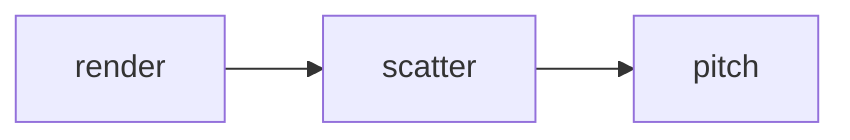

# Scatter Template: Design

On the table, a Blood Bowl player keeps the **Random Direction template** (the "scatter template") at hand: a 3 × 3 card whose 8 outer squares are numbered 1–8 for a D8 roll. The sandbox has no such template, so working out a scatter means counting squares in your head. This feature draws it on the pitch:
- a **semi-transparent 3 × 3 template**, always shown, fixed at the centre of the pitch, on both the Standard and the Sevens pitch;
- players **walk on it**: it lies under the tokens and never catches a click, a drag or a mark;
- a **Scatter** toggle button in the sandbox panel **highlights** it: while on, the template is drawn above the players.

Status: implemented (Phase 19 in [task.md](task.md)); the requirements are §3.15 of the [PRD](prd.md).
One change from the design: `draw_dice` draws the Scatter button (`draw_dice(..., scatter_on_top=False)`), not `draw_sandbox`. `draw_dice` runs after `draw_sandbox` and draws the section's 2 px top line along the caption row's top edge, so the line would cut into a button drawn earlier.
It builds on commit `b13d48e` (Phase 18, Sevens Zones).

**Simplified look (later change, from a user example):** the template is now only its numbers and a `*` on the centre, in pale yellow `SCATTER_TEXT = (240, 230, 140)`, with no fill and no lines; the numbering runs clockwise, `1 2 3 / 8 * 4 / 7 6 5`. `SCATTER_FILL`, `SCATTER_FILL_ON` and `SCATTER_LINE` are gone, `SCATTER_CENTRE = "*"` is new, and `_draw_scatter_template(surface, layout, font)` lost its `on_top` parameter: on and off now differ only in draw order. This supersedes the numbering, colours and overlay described below.

## Decisions

**Confirmed with the user**
1. **Template:** only the Random Direction template, numbered as in Third Season. No throw-in template.
2. **Look:** a semi-transparent overlay on the pitch. Players can stand and move on it.
3. **Position:** at the centre of the pitch.
4. **Toggle:** a button highlights the template above the players.
5. **Edges:** the template is clipped to the pitch.
6. **Dice:** no link. A 1d8 roll doesn't mark a square on the template.

**Defaults (veto any)**
- **Numbering** (Third Season), with the centre square blank:
  ```
  1 2 3
  4 · 5
  6 7 8
  ```
- **Centre square:** `pitch.ball_start`, the kick-off square, which is the centre of the pitch, just right of it on the even column count. The template covers:
  - Standard: columns 12–14, rows 6–8 (it straddles the line of scrimmage);
  - Sevens: columns 9–11, rows 4–6 (inside the middle zone).
- **Fixed:** the template never moves, and nothing can move it. It doesn't follow the ball.
- **Clipping:** at those centres the whole template is on the pitch on both sizes, so clipping never removes a square. It is still drawn on a pitch-sized overlay, as the marks are, so it can never spill off the pitch. No extra clipping code.
- **Off (default):** drawn between the pitch and the pieces, so tokens, the ball and a dragged item cover it.
  - Fill `SCATTER_FILL = (255, 255, 255, 60)`, a 1 px `SCATTER_LINE = (255, 255, 255, 160)` outline around each of the 9 squares, and the numbers in `SCATTER_TEXT = (20, 20, 20)` with the app font.
- **On (highlighted):** drawn after the pieces and before the marks, with a stronger fill, `SCATTER_FILL_ON = (255, 255, 255, 110)`; the lines and numbers are the same. The marks stay on top, so an arrow drawn across the template stays readable.
- **Draw order:** scene → template (off) → pieces → template (on) → marks → panel → context menu.
- **Input:** the template has no hit area. Clicks, drags, drops, marks and the player menu act on its squares exactly as on any other square. Only the Scatter button is new input.
- **Button:** "Scatter" at the right end of the **Dice caption row** (Italian "Deviazione"). That row only holds the "Dice" caption on the left, so nothing moves and the player info keeps its height.
  - Not next to Main menu: a missed click there leaves the sandbox and drops the board.
  - While on, it is drawn in `HIGHLIGHT`, as the picked row on the Options screen.
- **Button press:** toggles the template, then does nothing else.
  - Like any left press on the sandbox it clears the pitch marks (PRD §3.12).
  - Like a dice click it leaves an open comment edit alone and starts no drag.
- **Lifetime:** the toggle lives in `Session`, like the last dice roll:
  - Start, loading a saved setup and Main menu turn it off;
  - a trip to Team setups and back keeps it.
  - It is never saved, in setups or in `settings.json`.
- **Pitch image:** the template is drawn over the pitch image too.

## Screen

The dice section at square size 32 (see [dice.md](dice.md#screen)), with the new button:
```
+------------------------------+ y=304 dice_area
| Dice           [  Scatter  ] |   scatter_button: x 988-1096, one square high
| [1d6 ][2d6 ][1d8 ][1d16]     | y=336
| ...                          |
```
The pitch at the centre (Standard shown; Sevens is the same 3 × 3 around (10, 5)):
```
       col 12  13  14
row 6   [1] [2] [3]
row 7   [4] [ ] [5]        the line of scrimmage runs between 12 and 13
row 8   [6] [7] [8]
```

## Primitives

| Type | Module | Meaning |
|---|---|---|
| `RANDOM_DIRECTIONS` | scatter | `tuple[tuple[int, int], ...]`: the (column, row) step of each D8 result; index `n - 1` is result `n`: `(-1,-1) (0,-1) (1,-1) (-1,0) (1,0) (-1,1) (0,1) (1,1)` |
| `TemplateSquare` | scatter | NamedTuple `(square, number)`: one of the template's 9 squares; `number` is 1–8, or `None` for the centre |

## Modules

| Module | Status | Job |
|---|---|---|
| `scatter.py` | **new**, no pygame, no pydantic | `RANDOM_DIRECTIONS`, `TemplateSquare`, `random_direction_template` |
| `layout.py` | extend | `Layout.scatter_button`, placed by `_dice_region` |
| `language.py` + `languages/*.json` | extend | `Text.SCATTER` (`sandbox.scatter`): "Scatter" / "Deviazione" |
| `session.py` | extend | `scatter_on_top` state; the button in `_press_sandbox`; reset with `last_roll` |
| `render.py` | extend | `SCATTER_*` colours, `_draw_scatter_template`, the button in `draw_sandbox`; `_draw_button(..., selected=False)` |
| `app.py` | extend | passes `session.scatter_on_top` to `draw_sandbox` |

`board`, `interaction`, `pitch` and the file modules don't change. The template is display-only, so it never reaches `Board` or `Interaction`.


There are no cycles. `session` doesn't import `scatter`: it only holds a bool.

## Public interfaces

```python
# scatter.py
RANDOM_DIRECTIONS: tuple[tuple[int, int], ...]   # 8 steps, index n - 1 = D8 result n

class TemplateSquare(NamedTuple):
    square: Square
    number: int | None                           # 1..8, None for the centre

def random_direction_template(pitch: PitchFormat) -> tuple[TemplateSquare, ...]
    # the 9 squares around pitch.ball_start: the centre first, then 1..8

# layout.py
Layout.scatter_button: Box                       # right half of the dice caption row,
                                                 # BUTTON_INSET from the panel's right edge

# language.py
Text.SCATTER = "sandbox.scatter"

# session.py
Session.scatter_on_top -> bool                   # read-only property; False off the sandbox

# render.py
SCATTER_FILL = (255, 255, 255, 60)
SCATTER_FILL_ON = (255, 255, 255, 110)
SCATTER_LINE = (255, 255, 255, 160)
SCATTER_TEXT = (20, 20, 20)
def _draw_scatter_template(surface, layout, font, on_top: bool) -> None
def _draw_button(surface, font, box, label, enabled=True, selected=False) -> None
                                                 # selected fills with HIGHLIGHT
def draw_sandbox(..., message: str, scatter_on_top: bool = False) -> None
                                                 # the default keeps existing calls working
```

- `_draw_scatter_template` reads `layout.pitch_format` and lays `random_direction_template` out on a pitch-sized `SRCALPHA` overlay, as `_draw_marks` does, then blits it at the pitch's origin.
- `_press_sandbox` checks `scatter_button` after Team setups and before the dice buttons. It is a plain `if`, so the existing chain doesn't nest deeper.

## Invariants and errors

- The template always has 9 squares, with the numbers 1–8 once each, and all of them on the pitch, for every `PitchFormat`.
  Tests check this for both sizes, so a future pitch size whose centre sits on an edge fails a test rather than raising at draw time.
- `Square` raises `ValueError` if a step leaves the 26 × 15 grid. At `ball_start` that can't happen, so there is no error handling for it.
- The template never changes the `Board` and is never saved.
- No new errors and no user-facing messages.

## Testing

| File | Expected | Edge | Failure |
|---|---|---|---|
| test_scatter (new) | Standard: the centre is (13, 7) and result 1 is (12, 6), result 8 is (14, 8); Sevens: centre (10, 5) | on both sizes the 9 squares are distinct, all on the pitch, and numbered `None, 1..8` | — (nothing reads input; `RANDOM_DIRECTIONS` has 8 distinct steps, none `(0, 0)`) |
| test_layout | `scatter_button` lies in the dice caption row, right-aligned, inside the panel | it doesn't overlap the "Dice" caption text area's left half or any dice button | — |
| test_session | a click on Scatter sets `scatter_on_top`; a second click clears it; it returns `None` | Team setups and Back keep it; the click starts no drag and keeps an open comment edit | Main menu, then Start, turns it off; a click at its position on the main menu does nothing |
| test_render | off: a centre-template square with no player shows the blended fill; a player standing there covers it | on: the same player's token pixel is now blended with `SCATTER_FILL_ON`; on Sevens the template is drawn around (10, 5) | no pixel outside the 3 × 3 changes compared with a frame drawn before this feature |
| test_app | a click on Scatter, then a frame: the template is drawn on top | — | — |
| test_language_files | `sandbox.scatter` is in `en.json` and `it.json` | — | — |

**Existing tests:** none should change; `draw_sandbox`'s new parameter has a default. If a render test compares a full frame against a hard-coded pixel inside columns 12–14, rows 6–8, it now sees the template and needs updating.

**Manual check:**
1. Start a Standard match. A faint 3 × 3 with numbers 1–8 sits at the centre, across the line of scrimmage.
2. Drag a player onto square 5 and drop them: the token covers the number.
3. Click **Scatter**: the button turns blue and the template shows over the player. Drag the player away and back: dragging still works.
4. Right-drag an arrow across the template: the arrow is on top.
5. Team setups → Back: still highlighted. Main menu → Start: off again.
6. Options → Pitch size → Sevens, Start: the template is around (10, 5) in the middle zone.
7. Take a headless screenshot of both pitch sizes, off and on (SDL dummy driver).

## Build order

Tests first at each step, then `uv run pytest`.
1. `scatter.py` + test_scatter.
2. layout: `scatter_button` in `_dice_region` and `Layout` + test_layout.
3. language: `Text.SCATTER`, `en.json`, `it.json` + test_language_files.
4. session: `scatter_on_top`, the button, the resets + test_session.
5. render: colours, `_draw_scatter_template`, `_draw_button(selected)`, `draw_sandbox(scatter_on_top)` + test_render; headless screenshots.
6. app: pass `session.scatter_on_top` + test_app.
7. Docs: README "Scatter template" section; tick task.md; the status line here; `uv run ruff check src tests scripts` and `uv run black src tests`.

## Traceability

| Requirement (PRD §3.15) | Where |
|---|---|
| Random Direction template, numbered 1–8 | `scatter.RANDOM_DIRECTIONS`, `random_direction_template` |
| Semi-transparent, at the centre of the pitch, both sizes | `pitch.ball_start`; `render._draw_scatter_template`, `SCATTER_FILL` |
| Players walk on it | drawn before `_draw_pieces`; no hit area in `Layout` or `Interaction` |
| Toggle highlights it above the players | `Layout.scatter_button`, `Session.scatter_on_top`, `draw_sandbox` draw order |
| Clipped to the pitch | pitch-sized overlay; the fit test on both sizes |

## NASA rules

Checked against [architecture_principles.md](architecture_principles.md):
- **1:** `random_direction_template` is one comprehension; `_press_sandbox` gains one flat `if`.
- **2:** every loop is bounded by the 9 template squares.
- **3:** no resources; the overlay surface is a local of `_draw_scatter_template`.
- **4:** every new function stays at 60 lines or fewer. `_press_sandbox` grows by 3 lines.
- **5:** the fit test guards the one place a `ValueError` could come from.
- **7:** the toggle lives in `Session`; there is no module state.
- **8:** no I/O.
- **12:** the tests above.
