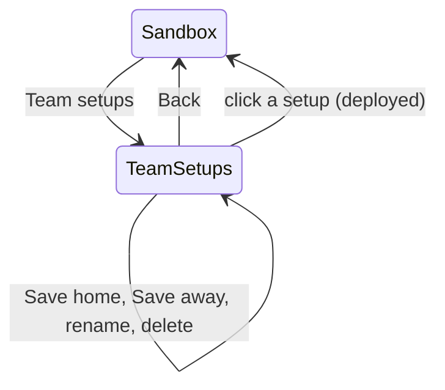
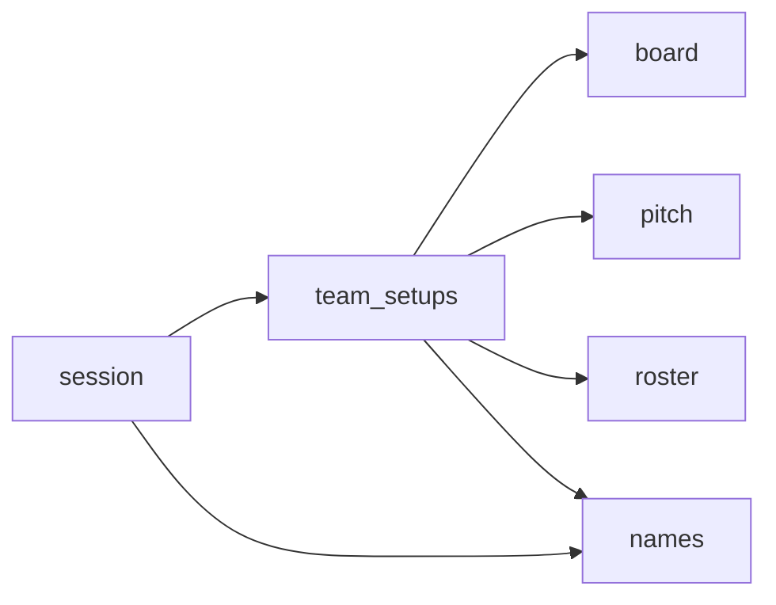

# Team Setups: Design

A **team setup** is one roster's formation: the square each of its players stands on. Each roster can keep as many named team setups as you like.
In the sandbox, a **Team setups** screen lists the Home and the Away team's setups. A click deploys one onto that team and returns to the pitch.
Team setups can be renamed and deleted. The main menu's rosters and saved setups can now be deleted too.

A **saved setup** (`setups/*.json`, see [names.md](names.md)) is different: it is the whole board, with both full rosters, every position and the ball.
A team setup holds no roster and no ball, so it works against any opponent.

Status: built (Phase 12 in [task.md](task.md)); the requirements are §3.11 of the [PRD](prd.md).

## Decisions

**Confirmed with the user**
1. A team setup holds **one team's positions**, and each roster has its own named setups. They are deployed in the sandbox from a **Team setups** screen. A deploy moves only that team, and Away gets the setup mirrored.
2. **Delete** is **Del** in the rename box, followed by a confirmation: Enter deletes, Esc cancels.
3. Delete works for **team setups, saved setups and rosters**. Deleting a roster also deletes its team setups, and unpicks the roster if it is imported as Home or Away.
4. On deploy, **KO and Injured players stay in their boxes**. Their squares stay empty, and they count as not placed.

**Defaults (veto any)**
- **Storage:** one JSON file per team setup, in a folder named after the roster: `rosters/<roster>/<setup>.json`. A team's name is its roster file's name, so the board's team name leads to the folder.
  - To "upload" a setup, copy its file there. The list rescans when the window regains focus, like every other list.
  - `.gitignore` already ignores `rosters/`, so team setups aren't committed.
  - `Session(...)` keeps its signature, because the folder comes from `rosters_dir`.
- **Orientation:** a file stores the squares as if the team played **Home**, on the left half. That half is columns 0–12, and column 12 is on the line of scrimmage.
  - Saving from Away and deploying on Away mirror the column (`25 - column`) and keep the row. So a setup that overloads the top flank still overloads the top.
- **What a setup holds:** the players on the pitch, by shirt number. Dugout boxes, Prone/Stunned and comments are not saved.
- **Deploy:**
  - Each listed player goes to their square, standing.
  - The team's other players on the pitch go to Reserve, standing.
  - KO and Injured players stay in their boxes (confirmed).
  - The other team, the ball and every comment stay as they are.
  - A square the other team holds stays empty, and the player it was for stays in Reserve.
  - A shirt number past the end of the roster is skipped.
  - The message is `Deployed <name>`, or `<n> not placed from <name>` when some listed players weren't placed. The count comes first because the panel's message line clips at about 32 characters.
- **Matching** is by shirt number (the roster row), as everywhere else in the app. A setup copied from another roster puts this roster's numbers on its squares.
- **Sandbox button:** **Team setups** shares the Save setup row as two 108 px buttons, `Save setup` on the left and `Team setups` on the right.
  - A new row doesn't fit. The dice must leave the player info its caption and eight rows, and a layout test pins `dice_area.y` at 304 or more.
- **Team setups screen:**
  - **Lists:** Home's setups go in the first menu column and Away's in the second. Each list has `option_rows` rows (15 at square size 32), plus a "+N more" row when they don't all fit.
  - **Captions:** `Home: <team>` and `Away: <team>`, clipped to the column. An empty list shows `No team setups yet`.
  - **Message line:** the message, or else the dim hint `Click a setup to deploy it, right-click to rename or delete it`.
  - **Buttons:** **Back** sits where New roster is, **Save home** where Start is, and **Save away** where Options is.
    - A Save button is dimmed while its team can't save: nobody of that team is on the pitch, or its name can't have team setups (see Names).
    - Clicking a dimmed Save button still explains why, e.g. `No home player on the pitch`.
  - **Coming and going:** opening the screen first saves an open comment edit, as Save setup and Main menu do.
    - Coming back, by Back or by a deploy, starts the pointer input fresh, so an open context menu closes.
    - The last dice roll stays.
- **Names:** the §3.9 rules apply ([names.md](names.md)). The default name is `setup-YYYYMMDD-HHMMSS`. The captions are `Save home setup as`, `Save away setup as` and `Rename team setup`.
  - A team whose name breaks the rules (say, from a hand-made `orcs.v2.csv`) can't have team setups. Its column stays empty, and Save says why: `orcs.v2: Names use letters, digits, spaces, - and _`.
  - The same check stops a team name read from a saved setup file from pointing outside `rosters/`.
- **Renaming a roster** renames its team setups folder too. If the folder can't be moved (`Folder <name> already exists`), the roster is renamed back and the box shows why.
- **Del in every rename box** (rosters, saved setups, team setups):
  - The hint reads `Enter: OK   Esc: cancel   Del: delete`.
  - Del asks first:
    - the field shows the file's name again, without a caret;
    - the caption becomes `Delete team setup?`, `Delete setup?` or `Delete roster and its team setups?`;
    - the hint becomes `Enter: delete   Esc: cancel`.
  - While it asks, typing, Backspace and Del do nothing. Enter deletes, and Esc closes the box.
  - The Save boxes ignore Del, since they have no file yet. A comment edit ignores it too.
- **Deleting a roster:**
  1. The CSV goes first. If that fails, nothing else changes and the box says why.
  2. Then each JSON file in its team setups folder goes.
  3. Then the folder goes, if nothing else is left in it. Any other files are kept.
  - The message is `Deleted <name>`, or `Deleted <name>, but <error>` when a team setup couldn't be deleted.
- **Deleting is permanent** (`Path.unlink`, no recycle bin), which is why it asks first.
- The main menu's hint becomes `Right-click a roster or setup to rename or delete it`.
- **Same roster on both sides:** both columns list the same files. A setup saved from either side deploys on either.
- **A sandbox loaded from a saved setup** uses the team names stored in that file. If the roster has been renamed since, its team setups are under the new name, so the screen doesn't find them.

## Screens and flow



At square size 32 (window 1120x656):
```
SANDBOX PANEL, bottom rows
| message line                 |
| [ Save setup ] [Team setups] |    two 108 px buttons on the old Save setup row
| [         Main menu        ] |

TEAM SETUPS
+------------------------+ +------------------------+ +------------------------+
| Home: Reavers          | | Away: Orcland          | |                        |
| Cage                   | | 3-4-4 offence          | |                        |
| Kick-off defence       | |                        | |                        |
| ... up to 15 rows      | |                        | |                        |
+------------------------+ +------------------------+ +------------------------+
 Click a setup to deploy it, right-click to rename or delete it    <- dim hint, or the message
            [ Back ]     [ Save home ]     [ Save away ]

RENAME BOX (right-click a setup)
+------------------------------------------+
| Rename team setup                        |
| [Cage|                                 ] |
| Enter: OK   Esc: cancel   Del: delete    |
+------------------------------------------+

AFTER Del
+------------------------------------------+
| Delete team setup?                       |
| [Cage                                  ] |
| Enter: delete   Esc: cancel              |
+------------------------------------------+
```

## Primitives

| Type | Module | Meaning |
|---|---|---|
| `TeamSetup` = `dict[int, Square]` | team_setups | One team's formation: roster index → square, as if the team played Home |
| `TeamSetupError` | team_setups | A team setup file can't be read, written or deleted, or fails validation |
| `EditKey.DELETE` | interaction | The Del key, free of Pygame. The name box uses it and a comment edit ignores it |
| `DeleteFile(path)` | session | The request to delete a roster, saved setup or team setup |
| `TeamSetupList`, `TeamSetupsView` | session | What the Team setups screen shows |

## Modules

| Module | Status | Job |
|---|---|---|
| `team_setups.py` | **new**, pydantic, no pygame | Capture and deploy on a `Board`; the JSON files; the per-roster folder |
| `names.py` | extend | `rename_folder` and `delete_file`; `rename_file`'s checks move into a private `_rename` that both rename functions share |
| `interaction.py` | extend | `EditKey.DELETE`; in `edit_key`, the catch-all `else` (Escape) becomes `elif key is EditKey.ESCAPE` |
| `layout.py` | extend | The split Save row, the two Save buttons and the team setup rows. The panel's button rows move into a `_panel_buttons` helper, so `build_layout` doesn't grow |
| `session.py` | extend | `Screen.TEAM_SETUPS`, four requests, the view, Del in the name box and `delete`. A roster rename moves its folder, and `rescan` lists the team setups |
| `render.py` | extend | `draw_team_setups`, the Team setups button, the name box hints, the new menu hint |
| `app.py` | extend | `K_DELETE`; four `_perform` cases; the TEAM_SETUPS branch of `_draw` |

`board`, `pitch`, `roster` and `setups` don't change. Like `setups`, `team_setups` sets positions only through Board's public API (`bench`, `place`).
It is the only new module that imports pydantic, and callers only see `TeamSetup` and `TeamSetupError`. Only `render` and `app` import pygame, as before.


`team_setups` uses `roster` for `MAX_TEAM_SIZE` and `names` for `name_problem`. There are no cycles.

## Public interfaces

```python
# team_setups.py
TeamSetup = dict[int, Square]            # roster index -> square, as if the team played Home
class TeamSetupError(Exception)          # a file can't be read, written or deleted, or fails validation
def capture(board: Board, side: Side) -> TeamSetup             # the side's players on the pitch; {} if none
def deploy(board: Board, side: Side, setup: TeamSetup) -> int  # how many listed players weren't placed
def team_setups_folder(rosters_dir: Path, team: str) -> Path | None   # rosters_dir / team; None if name_problem(team)
def list_team_setups(folder: Path) -> tuple[Path, ...]        # sorted *.json files; () if the folder is missing
def new_team_setup_path(folder: Path, when: datetime) -> Path  # setup-YYYYMMDD-HHMMSS.json
def save_team_setup(setup: TeamSetup, path: Path) -> None      # temp file + os.replace; creates the folder
def load_team_setup(path: Path) -> TeamSetup                   # validated; errors name the file
def delete_team_setups(folder: Path) -> None                   # its *.json files, then the folder if empty;
                                                               # a missing folder does nothing

# names.py
def rename_folder(folder: Path, name: str) -> Path   # same checks as rename_file, no suffix; never overwrites;
                                                     # FileNameError "Folder <name> already exists"
def delete_file(path: Path) -> None                  # FileNameError "Couldn't delete <file>: <reason>"

# interaction.py
class EditKey(Enum): BACKSPACE, ENTER, ESCAPE, DELETE

# layout.py
Layout.save_button: Box                  # now the left half of its row
Layout.team_setups_button: Box           # the right half: the sandbox's "Team setups"
Layout.save_home_button: Box             # Team setups screen, where start_button is
Layout.save_away_button: Box             # Team setups screen, where options_button is
Layout.team_setup_column(side: Side) -> Box                 # menu column 1 (Home) or 2 (Away), caption included;
                                                            # render clips a team's list to it
Layout.team_setup_row(side: Side, index: int) -> Box        # menu column 1 (Home) or 2 (Away), below the
                                                            # caption; index 0..option_rows-1, else ValueError
Layout.team_setup_row_at(pos) -> tuple[Side, int] | None    # inverse of team_setup_row

# session.py
class Screen(Enum): MENU; RACES; BUILDER; OPTIONS; TEAM_SETUPS; SANDBOX
@dataclass(frozen=True) class OpenTeamSetups                        # press(): the Team setups button
@dataclass(frozen=True) class DeployTeamSetup: side: Side; path: Path  # press(): a team setup row
@dataclass(frozen=True) class SaveTeamSetup: side: Side; name: str     # key(): Enter in a Save box
@dataclass(frozen=True) class DeleteFile: path: Path                  # key(): Enter while the box asks
FileRequest = (ImportRoster | LoadSetup | SaveSetup | SaveRoster | SaveSettings | RenameFile
               | OpenTeamSetups | DeployTeamSetup | SaveTeamSetup | DeleteFile)
class NameView(NamedTuple): caption; text; problem; deletable: bool = False; confirming: bool = False
class TeamSetupList(NamedTuple): team: str; setups: tuple[str, ...]; hidden: int; can_save: bool
class TeamSetupsView(NamedTuple): home: TeamSetupList; away: TeamSetupList
Session.board -> Board | None                 # None off the SANDBOX and TEAM_SETUPS screens
Session.interaction -> Interaction | None     # None off the SANDBOX screen
Session.team_setups_view() -> TeamSetupsView  # ValueError with no board
Session.open_team_setups() -> None            # lists both teams' setups, then shows TEAM_SETUPS
Session.deploy_team_setup(side: Side, path: Path) -> None
Session.save_team_setup(side: Side, name: str) -> None
Session.delete(path: Path) -> None            # a roster, saved setup or team setup
Session.rename(path: Path, name: str) -> None # unchanged signature; a roster's folder follows it
Session.rescan() -> None                      # also lists the board's team setups

# render.py
MENU_HINT = "Right-click a roster or setup to rename or delete it"
TEAM_SETUPS_HINT = "Click a setup to deploy it, right-click to rename or delete it"
DELETE_HINT = "Enter: OK   Esc: cancel   Del: delete"
CONFIRM_HINT = "Enter: delete   Esc: cancel"
def draw_team_setups(surface, layout, font, view: TeamSetupsView, message: str) -> None
# draw_sandbox and draw_name_box keep their signatures.

# app.py
KEYS[pygame.K_DELETE] = EditKey.DELETE
```

## Capture and deploy

**`capture(board, side)`** returns `{index: square}` for each of the side's players on the pitch, whatever their status. For Away the square is mirrored. Benched players are left out.

**`deploy(board, side, setup)`**:
1. Bench every one of the side's players on the pitch into Reserve.
   - This also stands them up.
   - `bench` can't refuse here: Reserve holds 18 players and a team at most 16. A `Reason:` comment says so.
2. For each `(index, square)` in the setup, the target is `square` for Home, or its mirror for Away. The player is skipped, and counted, if any of these holds:
   - the index names no player on the roster;
   - the player isn't in Reserve, so they are in KO or Injured;
   - `place` refuses because the other team holds the square.
3. Return the count.

The ball never moves. If a deployed player lands on the ball's square, they carry it, as with any drop.

## File format

```json
{
  "version": 1,
  "players": [
    {"number": 1, "square": {"column": 12, "row": 7}},
    {"number": 4, "square": {"column": 9, "row": 2}}
  ]
}
```
- `number` is the shirt number, 1–16. `square` is in Home orientation.
- A file lists 1–16 players, and no number or square appears twice.
- A bad file raises `TeamSetupError`, which names the file:
  - malformed JSON;
  - an unknown or missing key;
  - a `version` other than 1;
  - a number outside 1–16, or listed twice;
  - a square off the pitch, or used twice;
  - no players.
- Examples of the errors:
  - `Cage.json: players.2.number: Input should be less than or equal to 16`
  - `Cage.json: #4 is listed twice`
  - `Cage.json: two players on square (12, 7)`
- Saving works like the other files: a temp file, then `os.replace`, so a failed save never leaves half a file. The folder is created when needed.

## Session rules

- **SANDBOX:** **Team setups** saves an open comment edit and returns `OpenTeamSetups()`. Everything else is unchanged.
- **`open_team_setups()`:** lists both teams' folders, drops the Interaction, clears the message and shows TEAM_SETUPS.
- **TEAM_SETUPS, left click:**
  - **Back** returns to SANDBOX with a new `Interaction(board, layout)` and no message.
  - **Save home / Save away** opens the name box `Save home setup as` (or away), prefilled with `new_team_setup_path(folder, clock()).stem`. On Enter it returns `SaveTeamSetup(side, name)`.
    - If nobody of that side is on the pitch, or the team's name can't have setups, the message says so and no box opens.
  - **A visible setup row** returns `DeployTeamSetup(side, path)`. Captions, the "+N more" row and empty rows do nothing.
- **TEAM_SETUPS, right click** on a visible row opens `Rename team setup`, with Del asking `Delete team setup?`. On Enter it returns `RenameFile(path, name)`.
- **MENU, right click:** as today, plus Del, which asks `Delete roster and its team setups?` or `Delete setup?`.
- **`deploy_team_setup(side, path)`:**
  1. `load_team_setup`, then `deploy`.
  2. Back to SANDBOX with a new Interaction and the message `Deployed <name>` or `<n> not placed from <name>`.
  - A `TeamSetupError` stays on TEAM_SETUPS and becomes the message.
- **`save_team_setup(side, name)`:**
  - It calls `free_path(folder, name, ".json")`, then `save_team_setup(capture(board, side), path)`.
  - Success closes the box with `Saved <name>`. A `FileNameError` or `TeamSetupError` becomes the box's problem.
  - It checks again that someone is on the pitch, because it can be called without the button.
- **`delete(path)`:**
  1. It calls `delete_file(path)`.
  2. For a roster (`path in self._rosters`), it then calls `delete_team_setups` on the roster's folder, and sets any imported team named after the roster to None.
  - Success closes the box with `Deleted <name>`. A `FileNameError` from step 1 becomes the box's problem.
- **`rename(path, name)`:** works as today. For a roster that has a team setups folder, it then calls `rename_folder(folder, name)`. A `FileNameError` there renames the CSV back and becomes the box's problem.
- **`rescan()`** also lists `team_setups_folder(rosters_dir, board.team(side).name)` for both sides. A list is `()` when there is no board, or when the name can't have setups.
- **`can_save`** in the view is true when the side has a player on the pitch and its name can have setups.

## Name box: Del and the confirmation

- `_open_name_box` takes an optional delete option: the confirm caption and the `DeleteFile` request. Only the rename boxes get one.
- `key()`:
  - **Esc** closes the box, whether it is asking or not.
  - **While asking,** Enter returns the `DeleteFile`. Every other key, and all typing, does nothing.
  - **Del,** in a box with a delete option, starts asking: the caption becomes the confirm caption, the text goes back to the prefilled name and the problem clears.
    - In a box without one (the Save boxes), Del does nothing.
  - **Backspace and Enter** work as today.
- **`NameView`:** `deletable` is true when the box has a delete option, and `confirming` is true while it asks.
- **`draw_name_box` hint:**
  - `CONFIRM_HINT` while asking;
  - else `DELETE_HINT` for a box that can delete;
  - else `NAME_HINT`.
  - While asking, the text has no caret.
  - A problem still replaces the hint, e.g. `Couldn't delete Cage.json: Access is denied`.

## Invariants and errors

- `deploy` keeps every Board invariant, because it only calls `bench` and `place`. It never moves the other team or the ball, and it never changes a comment.
- Capture and then deploy on the same side puts the same players on the same squares, standing. On the other side, they land mirrored.
- No save or rename overwrites a file or a folder (`free_path`, `rename_file`, `rename_folder`). Nothing is deleted without the confirmation.
- User errors never raise. They become the box's problem, or the message when no box is open.
- Contract violations raise `ValueError`: `open_team_setups`, `team_setups_view`, `deploy_team_setup` or `save_team_setup` with no board.

## Testing

| File | Expected | Edge | Failure |
|---|---|---|---|
| test_team_setups | capture Home as-is and Away mirrored; deploy from Reserve onto Home, and mirrored onto Away; save/load round trip; the stored format | unlisted and prone players are benched standing; KO and Injured players are kept and counted; a number past the roster and a square the other team holds are counted; the ball, the other team and comments don't change; nobody on the pitch captures `{}`; `list_team_setups` returns sorted JSON files only, and `()` for a missing folder; `delete_team_setups` keeps a folder with other files | rejected files: version 2, numbers 0 and 17, a duplicate number or square, an off-pitch square, no players, an extra key, malformed JSON, a missing file; a failed save leaves no `.tmp`; `team_setups_folder` gives None for `../x`, `CON` and `''` |
| test_names | `rename_folder` moves a folder; `delete_file` deletes a file | a case-only folder rename | a taken folder name; a missing folder or file |
| test_interaction | Del with no edit open does nothing | — | Del leaves an open comment edit and its draft as they are |
| test_layout | the split row: both halves inside the panel, at the old y, not overlapping; Save home and away at Start and Options | `team_setup_row_at` inverts `team_setup_row` for both sides | it misses captions and points outside; an index outside 0..option_rows-1 raises |
| test_session | open the screen; a row deploys and returns with the message; Save home writes `rosters/<team>/<name>.json` | Back keeps the board and the roll; a mirror match lists the same files twice; a roster rename moves its folder; deleting a roster removes its folder and unpicks it | a bad file stays on the screen with the message; Save with nobody on the pitch; a taken name; Esc while asking; typing ignored while asking; Del ignored in a Save box; a taken folder rolls the roster rename back |
| test_render | the screen's captions, rows and hint; the Team setups button | "+N more"; the empty text; the message replaces the hint | dimmed Save buttons; the three name box hints, with no caret while asking |
| test_app | click → screen → row → deployed; Save home + Return writes the file | `WINDOWFOCUSGAINED` lists a copied file | right-click + `K_DELETE` + Return deletes the file; `K_DELETE` in a comment edit changes nothing |

**Existing tests:** one needed a change:
- the Save setup tests click at (x + 2, y + 2), which is inside the narrower button;
- `NameView`'s new fields have defaults, but a rename box is now `deletable`, so `test_right_click_on_a_roster_opens_the_rename_box` expects `deletable=True`;
- the three existing `EditKey` values behave as before.

**Manual check:**
1. Start Reavers (Home) against Orcland (Away). Drag 11 Reavers into a kick-off defence.
2. Team setups → Save home → `Kick-off defence`. Back.
3. On the main menu, swap the sides (Orcland Home, Reavers Away) and Start. In Team setups, click `Kick-off defence` in the Away column: the formation shows up mirrored on the right half.
4. Move a Reaver into KO and deploy again. Their square stays empty, and the message reads `1 not placed from Kick-off defence`.
5. Right-click the setup and rename it to `KO D`. Right-click it again, press Del, then Enter: it is gone.
6. On the main menu, rename the Reavers roster and check that `rosters/<new name>/` holds its setups. Then delete a saved setup with Del and Enter.

## Build order

Tests first at each step, then `uv run pytest`.
1. names: `_rename`, `rename_folder`, `delete_file`, + test_names.
2. `team_setups.py` + test_team_setups.
3. interaction: `EditKey.DELETE` + test_interaction.
4. layout: `_panel_buttons`, `team_setups_button`, `save_home_button`, `save_away_button`, `team_setup_row`, `team_setup_row_at`, + test_layout.
5. session: the requests and views, the TEAM_SETUPS screen, Del and the confirmation in the name box, `delete`, the roster rename's folder, `rescan`, + test_session.
6. render: `draw_team_setups`, the Team setups button, the name box hints and `MENU_HINT`, + test_render. Then check a headless screenshot of the sandbox panel, the screen and both box states.
7. app: `K_DELETE`, `_perform` and `_draw`, + test_app.
8. Docs: a README "Team setups" section, and Del in "Naming rosters and setups"; tick task.md; the status line here.

## Traceability

| Requirement (PRD §3.11) | Where |
|---|---|
| Team setups per roster | `team_setups.team_setups_folder`, `list_team_setups`; `rosters/<roster>/` |
| Save a team's positions | `Session._press_team_setups` (Save home/away), `save_team_setup`; `team_setups.capture`, `save_team_setup` |
| Quick deploy from the sandbox | `Layout.team_setups_button`, `Screen.TEAM_SETUPS`, `DeployTeamSetup`, `Session.deploy_team_setup`; `team_setups.deploy` |
| Either side, mirrored | `team_setups.capture` and `deploy` |
| KO and Injured stay | `team_setups.deploy` skips players who aren't in Reserve |
| Rename | `Session.right_click` on TEAM_SETUPS → `RenameFile`; a roster's folder: `Session.rename`, `names.rename_folder` |
| Delete team setups, saved setups and rosters | `EditKey.DELETE`, `Session.key`, `DeleteFile`, `Session.delete`; `names.delete_file`, `team_setups.delete_team_setups` |

## NASA rules

Checked against [architecture_principles.md](architecture_principles.md):
- **1:** at most 2 nesting levels in `deploy`, `Session.key`, `_press_team_setups` and `delete`.
- **2:** `capture` and `deploy` loop over at most 16 players each. Listing is bounded by the folder, and drawing by `option_rows`.
- **3:** files are opened with `with`. Saves write a temp file and `os.replace` it, and a failed save unlinks the temp file.
- **4:** every new function stays at 60 lines or fewer. `build_layout` doesn't grow, because the panel's buttons move into `_panel_buttons`. `_perform` grows to about 40 lines.
- **5:** pydantic validates team setup files when they load. `team_setups_folder` checks the team name before it becomes a path, because the name may come from a saved setup file.
- **6:** every failure becomes a message or a box problem. `deploy` ignores `bench`'s result only where it can't be False (deploy step 1).
- **7:** the screen's state (the two file lists) lives in `Session`. There is no module state.
- **8:** disk I/O happens only in the session methods that app calls: `open_team_setups`, `deploy_team_setup`, `save_team_setup`, `delete`, `rename` and `rescan`.
- **10:** still not enforced by any linter (already in task.md).
- **12:** the tests above.

## Notes

- `session.py` is about 890 lines and grows by roughly 150 here. Only the screen flow goes there; the formation rules live in `team_setups.py`.
- The board stays alive on the Team setups screen. `Session.board` is None only on screens other than SANDBOX and TEAM_SETUPS.
